<!-- Reference copy of the Shop OS architecture doc.
Source: https://claude.ai/artifact/Xi13pfEHjigMihzbPbtNhm (Claude Doc, exported to Markdown on 2026-11-14, rev 34).
The live doc is the source of truth; re-export and replace this file if it changes. -->

# Shop OS: Architecture, HLD, LLD, ER, Class Diagrams and DB Schema

Nov 13, 2026 · @Sir

## 1. Scope, assumptions and key decisions

Shop OS is designed as an offline-first ledger: each counter bills against its own local database, shares immutable records with one cloud server, and the owner app reads figures the server has already added up. The scale (500 bills a day per shop) is small, so the engineering effort goes into correctness offline and a catalogue that adapts to new product types without code changes, not into infrastructure.

Inputs: the Shop OS PRD (decisions of 12 Nov 2026) and the item-catalogue research file (electrical, plumbing, hardware, tools, paint). Requirement IDs such as FR-BIL-006 refer to the PRD.

### Assumptions I made

| # | Assumption | Effect if wrong |
| --- | --- | --- |
| A1 | One business, one shop at launch; up to 5 counters, 5 locations, 500 bills a day (NFR-014) | Schema already carries business\_id and shop\_id, so only onboarding work is added |
| A2 | A bill averages 6 lines (PRD gives no figure) | Capacity numbers in section 2 scale linearly |
| A3 | One builder, TypeScript and React skills or willingness to learn | If not, swap the client stack; the architecture does not change |
| A4 | Server is reachable over the internet from the shop most of the day | Offline design still holds; only sync lag grows |
| A5 | Hardware and tools templates in the catalogue research are unverified starter lists | Shipped as editable, not locked (section 6) |
| A6 | Scope tags (MVP, V2, V3) in the PRD are kept; the schema covers all releases so later modules need no migration of existing data | Tables for V2 and V3 stay empty until used |

### Decisions

| # | Decision | Why | What I rejected |
| --- | --- | --- | --- |
| D1 | Local-first clients plus a modular-monolith server | NFR-004, 005, 007 demand billing with no internet for 7 days; one builder must run it | Microservices, Kafka, Kubernetes: no requirement justifies them |
| D2 | TypeScript on every layer. Counter: Electron with React (Windows, Mac, Linux). Owner and Godown: React Native (Android phone). Android tablet counter: React Native. All logic lives in shared packages; only the UI shell differs | NFR-013 needs desktop and Android; one person cannot keep two codebases | Native per platform; Electron plus a separate Android app |
| D3 | SQLite (encrypted) on devices, PostgreSQL on the server | Mature, zero-admin, same SQL dialect family, easy to back up | A document database; a custom store |
| D4 | One shared pure-TypeScript package, shopos\_core, holds pricing, GST, units, rules, catalogue validation and title rendering; client and server both import it | The same bill must price and tax identically offline and online (NFR-005) | Re-implementing rules on the server in another language |
| D5 | Sync by exchanging append-only operations with idempotent IDs; the server assigns a global order | Simple to reason about; two counters selling the same item both survive (NFR-005) | CRDT libraries; last-write-wins on whole rows |
| D6 | Money in integer paise, quantities in thousandths of the base unit, tax rates in basis points | No rounding drift; exact sums for ledgers | Floating point and decimals in app code |
| D7 | IDs are UUIDv7 made on the device; bill numbers come from a per-counter series (C1/26-27/000123) | Counters never clash (FR-BIL-013) | Server-issued sequence numbers (needs internet) |
| D8 | Ledger-first: stock, party balance and cash are sums of immutable entries; tables like stock\_balance are rebuildable caches | Every number traces to its source (NFR-015); matches the PRD core idea | Mutable quantity columns |
| D9 | The catalogue is data, not code: category templates and attribute definitions drive forms, validation, titles and search, shipped as versioned packs | The research shows each product type has different axes, units and compliance fields, and rates and standards changed several times in 2021-2026 | One hard-coded column set per product type |
| D10 | Multi-tenant from day one: business\_id and shop\_id on every row plus PostgreSQL row-level security | Pilot shops later without a rewrite (decision of 12 Nov) | Adding tenancy after launch |
| D11 | One small VM running the server and PostgreSQL, S3-compatible object storage for backups and photos, push through FCM | Low running cost; one person can operate it | Managed Kubernetes, multi-region |

These are my recommendations, not agreements. D2 and D4 are the two I would revisit first if you have strong skills in another language.

## 2. Architecture drivers and capacity estimate

Throughput is not the hard part: one shop produces about 10,000 rows a day. The drivers that shape the design are offline billing, no lost or duplicated bills, and a catalogue that must absorb very different product types.

### Quality expectations and what each one forces

| PRD item | Expectation | Design consequence |
| --- | --- | --- |
| NFR-001 | Search in about 0.2 s over 50,000 items | Search runs only on the device: an in-memory index (names, aliases, barcodes) with typo tolerance, backed by SQLite full-text search; ranked by recent sales |
| NFR-002 | Save and print a bill in about 1 s, even offline | One local SQLite transaction writes the bill, lines, stock movements, ledger and the outbox record; printing starts after commit and its failure never rolls back the bill (FR-BIL-015) |
| NFR-003, FR-OWN-005 | Today card within 3 s on a weak phone connection | Server keeps a daily\_snapshot row per shop; the phone fetches one small JSON and shows its age |
| NFR-004 | 7 days offline; sync within a minute of reconnecting | Outbox plus a background sync agent with backoff; the device holds all data it needs to bill |
| NFR-005 | Zero lost or duplicate bills; two counters changing the same stock keep both changes | Idempotent operation IDs, per-counter bill series, additive stock ledger |
| NFR-006 | Cloud backup every 15 min, daily second-drive copy, restore in 30 min | PostgreSQL continuous archiving to object storage; the Counter app writes a daily encrypted copy; a replacement PC bootstraps from a server snapshot |
| NFR-007 | Online services 99.5% a month | 99.5% of a 720-hour month allows 3.6 hours down; one VM with automated restore fits, and counters never depend on it |
| NFR-008, 009 | Encrypted storage and transit, hashed PINs, remote logout, consent records | Encrypted SQLite, TLS, Argon2id PIN hashes, per-device tokens the owner can revoke, consent tables (section 8) |
| NFR-015 | Any number traceable in 3 taps | Every ledger row stores doc\_type and doc\_id; every report endpoint returns document lists |
| NFR-016 | Limits, rates, classes changeable without a release | Dated settings and rates; catalogue templates as data (section 6) |

### Capacity estimate

Inputs marked (PRD) come from the PRD; the rest are my assumptions and must be measured in Phase 0.

| Quantity | Calculation | Result |
| --- | --- | --- |
| Bills per day per shop | PRD NFR-014 | 500 |
| Lines per day | 500 bills x 6 lines (A2) | 3,000 |
| Rows written per bill | 1 bill + 6 lines + 6 stock movements + 1.3 tenders + 0.3 ledger + 0.6 cash + 1 audit | about 16 |
| Rows per day, all activity | 500 x 16 x 1.25 (allowance for receipts, payments, counts, quotes) | about 10,000 |
| Rows per year | 10,000 x 310 trading days | about 3.1 million |
| Rows in 10 years (PRD) | 3.1 million x 10 | about 31 million |
| Disk per year | 3.1 million rows x about 500 bytes with indexes | about 1.5 GB |
| Disk in 10 years, server | 1.5 GB x 10 | about 15 GB |
| Disk on a device | masters (50,000 variants x about 1.5 KB = 75 MB) + 24 months of documents (3 GB) | about 3 GB |
| Busy hour | 15% of the day's bills | about 75 bills, 1.25 a minute across all counters |
| Sync load, one shop | 10,000 rows over an 8-hour day | about 0.35 rows a second |
| Sync load, 10 pilot shops | 100,000 rows over 8 hours; 10x burst | about 3.5 rows a second; 35 at burst |
| Sync load, 100 shops | 1 million rows over 8 hours; 10x burst | about 35 rows a second; 350 at burst |

What this means:

- One PostgreSQL instance covers the pilot with a wide margin. At 100 shops I would run a load test before trusting a single node, not assume it.
- Devices keep all master data but only the last 24 months of documents; older documents are fetched from the server on demand. Ten years on a tablet is the limit that bites first.
- A device offline for 7 days at 10,000 rows a day produces under 70,000 rows to upload (a counter produces about a fifth of the shop's rows), which syncs in well under a minute on a normal connection. I have not benchmarked this; it is arithmetic.

## 3. Architecture: style, options, tech choices, trade-offs

I recommend option B below: each device owns a complete local database and the server is a synchronisation and reporting hub, not a dependency of the counter. The architecture stage is MVP; the same shape carries growing-product and multi-shop scale without redesign, as section 12 shows.

### Options considered

| Criterion | A. Cloud-first POS with an offline cache | B. Local-first devices plus sync server (recommended) | C. Mini-server in the shop plus cloud copy |
| --- | --- | --- | --- |
| Billing for 7 days without internet (NFR-004) | Possible but bolted on: cache, queue and conflict rules all added late | Native: the local database is the system of record for that device | Works while the shop LAN and the mini-PC are up |
| Single point of failure at the counter | Internet and server | None for billing | The mini-PC |
| Two counters see each other's stock with no internet | No | No, until sync resumes | Yes |
| Solo build and support effort | Medium | Medium; sync correctness is the main work | High: hardware, OS patching and backups per shop |
| Restore a lost PC in 30 minutes (NFR-006) | Easy | Easy: new device pulls a server snapshot | Needs the mini-PC image plus cloud |
| Fit to risk register (offline bills lost) | Weak | Strong | Strong, but with the mini-PC as new risk |

Why B: it removes the dependency the PRD says must not exist, and it needs no extra hardware. The cost is one known weakness: with the internet down, two counters can each sell the last unit. Both sales are kept, stock goes negative, and the exceptions list flags it (FR-STK-007). When a shop has more than two counters that must see live stock during outages, move to option C by adding a LAN peer-sync mode (listed in section 12).

### Technology choices

| Layer | Choice | Why | Alternative and when I would switch |
| --- | --- | --- | --- |
| Client | TypeScript: Electron with React (desktop counter), React Native (phones and tablet) | One codebase for Mac, Windows, Linux and Android; fast keyboard-driven grids are feasible | Flutter with Dart if one UI codebase matters more than shared TypeScript logic (the rules would then need a second implementation); or native Android if React Native printing proves unreliable in the first spike |
| Local data | SQLite with SQLCipher encryption, accessed through Drizzle or Kysely with one driver adapter per platform (confirm driver choice in the first spike) | Typed queries, migrations, full-text search, online backup API | None needed |
| Shared logic | shopos\_core (pure TypeScript) | One implementation of pricing, GST, units, rules, catalogue validation | None; this is what prevents offline and online disagreeing |
| Server | Node.js service on NestJS, one process, modular monolith | Reuses shopos\_core; one language to learn | TypeScript if you prefer it, at the cost of duplicating the core |
| Database | PostgreSQL 16 | Row-level security, JSONB for catalogue attributes, continuous archiving | None needed |
| Files | S3-compatible object storage | Backups, delivery photos, voice notes | Local disk until the pilot |
| Push | Firebase Cloud Messaging | Approval requests reach the owner phone within 10 s (FR-OWN-004) | None |
| Receipts and labels | ESC/POS thermal printing, PDF for A4/A5, barcode labels | NFR-013 | Print through the OS driver if a printer lacks ESC/POS |
| WhatsApp | Share links first (wa.me plus a hosted PDF link) | PRD says buy, do not build; business messaging comes later | WhatsApp Business API at the pilot |

### Server modules (bounded contexts)

Each module owns its tables and exposes application services; other modules call those, never read its tables. Inside one process this is enforced by TypeScript package boundaries and a lint rule that forbids importing another module's repositories, so a module can be extracted later if it ever needs to be.

| Module | Owns | PRD areas |
| --- | --- | --- |
| identity\_access | business, shop, user, role, permission, device | CTL |
| catalogue | categories, templates, attribute definitions, items, units, tax rates, aliases, import | ITM |
| tinting | shades, formulas, tinting charges | TNT |
| sales | bills, quotations, returns, number series | BIL |
| delivery | deliveries, dispatch, proof of delivery | DLV |
| inventory | locations, stock movements, balances, rolls, counts, licence meter | STK |
| khata | parties, ledger, payments, cheques, reminders, commission | KHA |
| purchasing | receipts, purchase bills, schemes, price history | PUR |
| warranty | register, cases, claims | PUR (warranty) |
| control | approvals, audit log, cash day-close, exceptions | CTL, OWN |
| compliance | registration, GST export, consent, asset register | CMP |
| reporting | projections, daily snapshot, exports | RPT, OWN |
| sync | operation log, cursors, conflicts, snapshots | NFR-004, 005 |

Communication: devices talk to the server only through the Sync API (writes and change feed) and the Query API (owner reads). Inside the server, modules publish in-process domain events after commit, which update projections and trigger push. There is no message broker.

### Deliberately left out

- Microservices, Kafka, Kubernetes: one process and one database meet every requirement; each would add operations work for a solo builder with no benefit.
- Redis or any server cache: reads hit precomputed projection tables; adding a cache would add an invalidation problem.
- Elasticsearch: search is on the device, where it must be.
- Full event sourcing: documents stay the source of truth, and ledger rows are written with them in one transaction. I take the audit and traceability benefits without the replay and versioning cost.

## 4. High-level design (HLD)

Four views: who uses the system, what runs where, how the server is built inside, and how it is deployed. Diagrams are Mermaid, so they stay editable as text.

### 4.1 System context

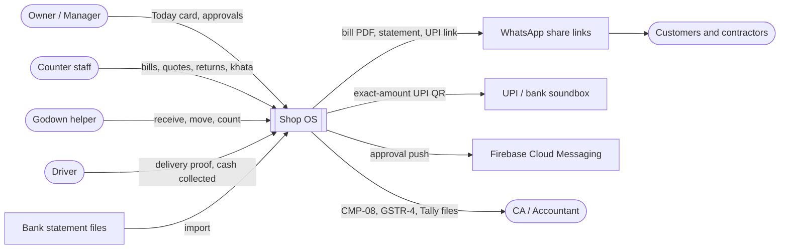

### 4.2 Containers: what runs where

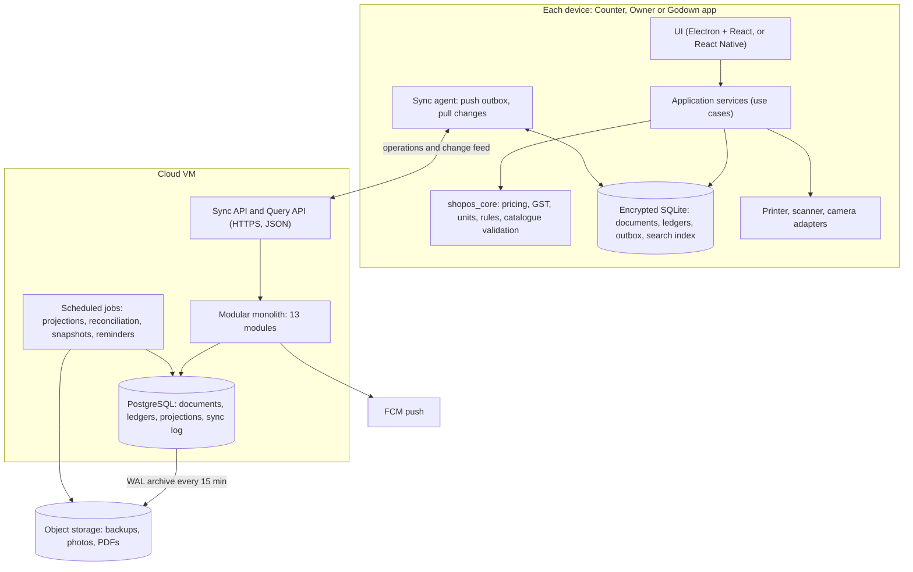

### 4.3 Server components

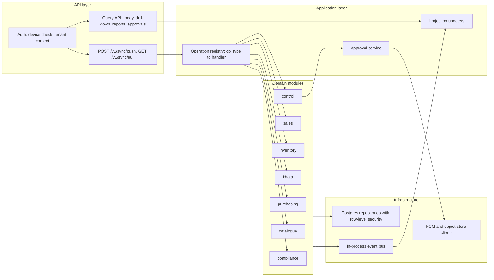

### 4.4 Deployment

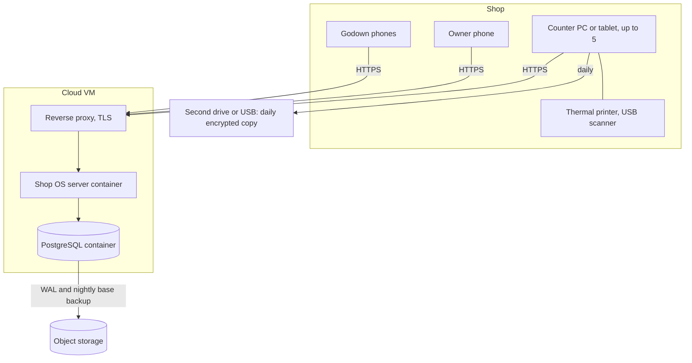

Environments are development, staging (same schema, fake data, used for offline-simulation tests) and production. Server releases are a container image plus forward-only SQL migrations written expand-then-contract, so the previous image still runs after a rollback. App releases reach the shop every 2 weeks and the previous version stays installable (PRD release practices).

### 4.5 Main data flows

1. **Counter bill, online or offline.** The UI calls PostBill; shopos\_core prices, taxes and checks rules; one SQLite transaction writes the bill, lines, stock movements, tenders, ledger rows and one outbox operation; the receipt prints. The sync agent uploads the operation whenever a connection exists.
2. **Approval.** A rule returns NeedsApproval. With the owner present, the PIN is entered on the counter and recorded as a local approval. Remotely, the device sends an approval request to the server, which pushes to the owner phone; the owner decides within 2 minutes or the action stays unsaved (FR-CTL-003).
3. **Owner reads.** The server applies each uploaded operation to PostgreSQL in one transaction and updates stock\_balance, party\_balance and daily\_snapshot. The owner app reads these projections, so the Today card is a single small query.
4. **Other counters.** They pull the same operation from the change feed using a cursor and apply it to their local database, which keeps stock and balances converging.

## 5. Offline-first sync design

Sync exchanges immutable operations. Correctness comes from making almost every operation additive, so order does not matter, and from giving the few that are not additive an explicit rule. This section is the part of the system I would test hardest, because the PRD risk register ranks lost or duplicated offline bills as the most damaging risk.

### 5.1 The operation envelope

| Field | Meaning |
| --- | --- |
| op\_id | UUIDv7 made on the device; the server uses it to ignore duplicates |
| device\_id, device\_seq | Which device wrote it, and a gap-free counter per device so the server can detect a missing operation |
| hlc | Hybrid logical clock: orders operations across devices even when wall clocks differ |
| op\_type | For example sales.bill.post, inventory.movement.add, khata.payment.receive, catalogue.item.update |
| schema\_v | Version of the payload format, so old devices stay readable |
| business\_id, shop\_id, actor\_user\_id | Tenant and who did it |
| payload | JSON: the full set of facts (a bill carries its lines, tenders, stock movements and ledger rows) |

```json
{
  "op_id": "019325a2-7c1e-7b3a-9d10-2f6c1a0e44aa",
  "device_id": "counter-1",
  "device_seq": 4821,
  "hlc": "2026-11-13T09:14:05.113Z-0003-c1",
  "op_type": "sales.bill.post",
  "schema_v": 3,
  "payload": {
    "bill": { "id": "...", "bill_no": "C1/26-27/000123", "total_paise": 185000 },
    "lines": [],
    "tenders": [],
    "stock_movements": [],
    "ledger": []
  }
}
```

The device decides prices, tax and rule outcomes, because it may be offline. The server does not recompute and reject a bill, since the customer already holds it. Instead it recomputes totals with shopos\_core, and a mismatch creates a high-severity exception for the owner while the bill is still accepted.

### 5.2 Protocol

1. **Write.** The use case writes domain rows and one outbox row in the same SQLite transaction. If the app crashes, both exist or neither.
2. **Push.** The sync agent sends up to 500 operations in device\_seq order. For each, the server in one transaction: returns duplicate if op\_id is known; asks for a resend if device\_seq is not last+1; checks tenant and device validity; runs the handler; appends to sync\_log (which assigns server\_seq); updates projections.
3. **Reply.** Per-operation status: applied, duplicate or quarantined. Quarantined operations (for example an unknown item) are kept, shown to the owner and never dropped; they do not block later operations.
4. **Pull.** The device asks for changes after its cursor, excluding its own. It applies them in server\_seq order in one transaction and advances the cursor, so a crash mid-pull simply repeats.
5. **Backoff.** Failures retry with exponential backoff and jitter, capped at one minute so NFR-004 (sync within a minute) holds.

The push and pull are both idempotent, so retrying after any failure is always safe.

### 5.2.1 Sequence: offline bill, then convergence

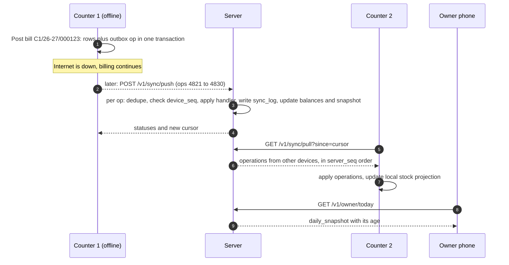

### 5.3 Conflict rules by kind of data

| Data kind | Examples | Rule | Why |
| --- | --- | --- | --- |
| Append-only facts | bills, lines, payments, stock movements, ledger and cash entries, delivery events, audit rows | No conflict: unique IDs, never updated | Two devices cannot produce the same fact |
| Derived balances | stock\_balance, party\_balance, daily\_snapshot | Never synced as state; each side recomputes by applying the same entries | Sums are order-independent, so both counters' sales are kept (NFR-005) |
| Document changes | cancel, edit after save | Modeled as new operations on a document version; if two edits meet, the later HLC wins, the other is kept in bill\_revision and flagged | Same-day edits by permitted roles only (FR-BIL-017), so collisions are rare |
| Master data | items, parties, prices, tiers, locations | Field-level last-writer-wins by HLC; conflicts on money fields (selling price, cost, MRP, credit limit, tier) are written to sync\_conflict for owner review | Avoids losing one editor's change to an unrelated field |
| Settings and rules | GST registration, role permissions, discount limits, licence limits | Server-authoritative; Owner edits online; devices cache with effective dates | A rule that differs per device would be a control failure |
| Catalogue templates | categories, attribute definitions, options | Server-authoritative, versioned packs; shop extensions are separate rows | See section 6 |
| Numbers | bill, quote, receipt numbers | Device-owned series per counter; no conflict by construction | FR-BIL-013 |
| Approvals | below-cost, over-limit, cancel | Single-use, bound to one subject; remote ones are mediated by the server | A reused approval would defeat the control |

### 5.4 Keeping bill numbers safe

A series key is (shop, counter code, financial year, document format). On enrolment or restore the server returns the highest number it has seen for each series, and the device resumes at the larger of its own and the server's value plus one, so a PC restored from a stale backup cannot reuse numbers. The database also has a unique constraint on (shop, bill\_no). A duplicate arriving with a different op\_id should be impossible; if it happens it goes to quarantine as a high-severity exception, never silently overwriting a tax document.

### 5.5 Clocks

Ordering uses the hybrid logical clock; wall time is stored only for display and for the bill date. A device remembers the latest time it has seen and refuses to bill if its clock moves backwards until the owner confirms. At sync, a skew above 5 minutes against the server marks the device and shows a banner. Seven days offline is normal, so an old bill date is never an error by itself.

### 5.6 Versions and migrations

Operations carry schema\_v; the server accepts the current and previous version, and the release rule is that outbox payloads stay forward-compatible JSON. A device that is too old for the server keeps billing locally and queues operations until it is updated; it is never locked out of billing. The local database migrates at app start inside a transaction, after an automatic copy of the file.

### 5.7 New device and restore

The owner approves a new device. It downloads the latest per-shop snapshot (a SQLite file built nightly on the server), verifies its checksum, then pulls operations after the snapshot's cursor. This is how a lost computer is replaced in 30 minutes (NFR-006); I have estimated the snapshot at a few hundred megabytes for 24 months of documents, which is arithmetic from section 2, not a measurement.

### 5.8 What happens when things go wrong

| Failure | Behaviour |
| --- | --- |
| Connection drops mid-push | Server keeps the operations it applied; the device resends the batch; duplicates are ignored |
| Same batch sent twice | Every operation returns duplicate; no double stock or ledger entries |
| Server down | Counters bill normally; the banner shows unsynced age; owner app shows data freshness |
| Device offline 7 days | Backlog uploads in batches of 500; counters pull the backlog the same way |
| Operation rejected for integrity | Quarantined, visible to the owner, later operations continue |
| Local database corrupt | Restore the daily second-drive copy or the server snapshot, then pull; operations not yet uploaded and not in any copy are lost, so the app warns after 24 hours without sync (PRD sync-health guardrail) |
| Two users share one device | Each operation records the actor and device; sync is per device, not per user |

## 6. Item catalogue design: scalable, extensible, maintainable

The catalogue research covers about 30 product types whose variant axes, units, ratings and compliance fields all differ, and whose tax rates, standards and pack lists changed several times between 2021 and 2026. So the catalogue is a small generic engine plus data: categories, templates and attribute definitions live in tables and versioned packs, and adding a product type is a data release, not a code change.

### 6.1 What the research requires, and the design response

| Finding in the research | Design response |
| --- | --- |
| One parent product, one to three variant axes: wire is size x colour; MCB is poles x rating x curve; switch is function x rating x module; paint is tint base x pack | Item family (parent) plus item variant (child SKU); each template names 1 to 4 axes (PRD FR-ITM-001 allows 4) |
| Each pipe material has its own size system and its own rating system (Class, SDR, Schedule, PN, Light/Medium/Heavy, Type A/B) | Typed attributes size\_system, size\_mm, size\_label, rating\_type, rating\_value; dependent options that apply only when another attribute has a given value |
| Sale and purchase units differ: coil vs metre, kg vs length, pair vs piece, bundle vs piece | Unit master mapped to the GST unit codes (UQC), plus per-variant conversions, including kg per metre for GI pipe |
| Declared net quantity differs from the trade label (a 3.6 L base is sold as "4 L") | Two separate fields: declared net quantity with unit, and trade label |
| Four compliance regimes (ISI licence, CRS R-number, BEE star, PESO petroleum class) and QCO coverage that changes | Compliance scheme master, compliance records per item or batch, and dated QCO rules; none of this is a hard-coded column |
| Tax is almost uniformly 18%, but LED lamps and luminaires moved from 12% to 18%; a few items sit at 5% | Dated HSN rates; category default HSN, overridable per variant; a golden test for the LED case |
| MRP is per batch, with a ceiling check | Batch table carries MRP (already in the schema); billing reads the batch |
| Marketplaces repeat the key attributes in the title | Per-category title templates generate the display name |
| Counter vocabulary is ambiguous ("patti", "kabja", "gitti" each mean two things) | A trade alias dictionary where one term can point to several targets with a disambiguation prompt |
| Fastener, bracket, handle and hand-tool lists, many aliases and several QCO statuses are unverified | Verification status and source on every option and template; enum policy locked, extensible or open |
| Paint shade is added at tinting time, not stored as an SKU | Variants are tint base x pack; shade and recipe attach to the sale line through the tinting module |
| Accessory bundles are separate SKUs, not variants | Kit items with components (FR-ITM-015), never an axis |
| Marketplace data is wrong in places (a hinge thickness filled as "2 inch") | Import validates every value against its attribute type, unit and allowed range |
| The shop's own measuring tape must be stamped and reverified every 24 months | Asset register with a reverification date (FR-CMP-006) |

### 6.2 The model

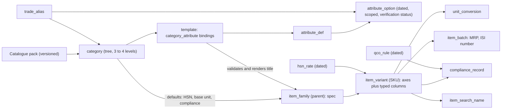

Five layers, from most stable to most changeable:

1. **Category tree.** Three to four levels (for example Electricals > Wires and Cables > House Wire). A node can carry defaults: HSN, base unit, alternate units, required compliance schemes, title template. A child inherits from its nearest ancestor.
2. **Template.** The set of attributes that apply to a category, as bindings: which attribute, at which level (family spec, variant axis or SKU detail), required as Y, C (conditional) or N, its order, and whether it appears in the title.
3. **Attribute definition.** A key, a data type, a unit kind, limits, and an option list where the type is enum. Options can be scoped (valid only when material is uPVC-IS) and dated.
4. **Items.** An item family holds the parent-level values; each item variant holds its axis values and the typed columns the counter needs on every bill.
5. **Pack.** A versioned bundle of the above. System rows come from packs; shop rows extend them. Nothing a pack ships is edited in place.

### 6.3 Attribute data types

| Type | Stored as | Example | Validation |
| --- | --- | --- | --- |
| enum | option key | colour = red; curve = C | Must be an active option whose scope matches the other attributes |
| int, decimal | number | poles = 3; wattage = 9 | Min, max, step |
| measure | value in thousandths plus a unit code | size = 32 mm; coil = 90 m; sweep = 1200 mm | Unit must belong to the attribute's unit kind; range check; inch labels are display only |
| text | string | series = Maxima Plus | Length |
| bool | true or false | flange = yes | None |
| date | ISO date | mfg month | Valid date |

Two rules from the research make dependent behaviour data, not code. A **scoped option** applies only when another attribute matches (the size list for CPVC differs from that for uPVC-IS; the HDPE grade applies only to HDPE). A **conditional requirement** is a tiny JSON condition on a template binding, evaluated by one shared function in shopos\_core, for example "required when material is HDPE".

### 6.4 Where each value is stored

| Kind of value | Stored in | Why |
| --- | --- | --- |
| Fields billing and rules read on every bill: category, brand, HSN, base unit, prices, declared quantity, petroleum class, sealed-pack flag, warranty, serial tracking, roll flag | Typed columns on item\_variant | Fast, indexable, enforced by the rule engine |
| Parent-level specification (standard, material, series, voltage grade, base chemistry) | item\_family.spec (JSON) | Varies by category; adding an attribute needs no migration |
| Variant axis values (size, colour, poles, rating, curve) | item\_variant.axes (JSON) plus a canonical axis\_signature | Drives the variant grid and the uniqueness check |
| Compliance identifiers (ISI CM/L, CRS R-number, BEE star and label validity) | compliance\_record rows | New schemes and validity dates appear without schema change; one item can hold several |
| Search text | item\_variant.search\_text plus item\_search\_name | Local full-text search stays simple |

I chose this hybrid deliberately. A pure attribute-value table forces joins on every lookup, which hurts on a tablet, and it loses types. A wide table with a column for every attribute needs a migration for every new product type. Typed columns for the hot path plus JSON for the long tail avoids both. Type safety comes from validating JSON against the template in shopos\_core on every write, on the device and on the server.

### 6.5 Variants, uniqueness and duplicates

Creating a family with chosen axis values generates the full combination grid in one step and the user deletes combinations that are not stocked (FR-ITM-002). Each variant stores a canonical axis\_signature (axis keys sorted, for example colour=red|size\_sqmm=1.5), and the database enforces one variant per (family, signature). The duplicate warning at creation (FR-ITM-008) compares brand, category and signature against existing families before saving. Kits and accessory bundles are separate items with components and never become axes.

### 6.6 Units, conversions and declared quantity

A unit master lists each unit with its GST unit code (UQC) and dimension (count, length, mass, volume, area). Each variant has one base unit, and stock is always kept in the base unit as thousandths. Other units are conversions stored per variant, because the factor depends on the SKU: a 90 m coil, a 100 m coil, kg per metre by pipe class and size. Billing and purchase may use any defined unit (FR-ITM-004); the line stores the quantity as entered and the base quantity. The UQC mapping feeds the HSN summary in the GSTR-1 export. The category-to-UQC mapping in the research is the author's inference, so it ships as unverified defaults.

| Product | Base unit (UQC) | Alternate units and notes |
| --- | --- | --- |
| House wire | MTR, decimals on | ROL = 90 m (also 91 and 100). A sealed coil is a packaged commodity; wire cut from it is sold by measure |
| Multicore cable | MTR | ROL = 100 m; drum or per metre for armoured |
| GI pipe | MTR | Purchased per kg: KGS conversion by class and nominal bore (kg per metre), which differs per variant |
| Conduit pipe | NOS (3 m length) | BDL = 100, 50 or 25 pipes by size |
| Butt hinge | NOS | PRS = 2; per-piece versus per-pair practice is unverified |
| Nails | KGS, decimals on | Bags of 25 or 50 kg; pouches of 0.48, 1 and 2.5 kg |
| Tint base paint | LTR | Declared net 3.6 L with trade label "4 L"; sealed pack, whole numbers only |
| Solvent cement | MLT | TUB or CAN packs of 29.5 to 946 ml |
| MCB, switch | NOS | BOX = 10 or 90 where the brand packs that way |

**Declared net quantity and trade label** are separate fields on the variant: declared\_qty with its unit, and trade\_label as free text. Legal Metrology no longer fixes pack sizes (from 1 April 2022), so any declared size is accepted, and the unit sale price (price per litre, kg or metre) is calculated for bills and shelf labels from the declared quantity. The old base-paint size list (450 ml, 900 ml, 3.6 L and so on) ships as a pick-list of options, not as a rule.

### 6.7 Tax and compliance

**Tax.** The HSN comes from the variant, else the family, else the category default, and is stored at 4, 6 or 8 digits (8 preferred). The rate is the hsn\_rate row in force on the bill date; a variant may carry a rate override for the few exceptions (hand pumps, lanterns, animal shoe nails at 5%). A rate change is one new dated row, never an edit to thousands of items, and a back-dated offline bill still uses the rate of its own date. The seed data applies 18% from 22 September 2025 across the basket per the research; LED lamps (8539) and luminaires (9405) were 12% before that date and have a golden test so the trap cannot return. A pre-change report lists items affected by a coming rate change.

**Compliance** is data, in three parts.

- compliance\_scheme: ISI licence (CM/L), CRS registration (R-number), BEE star with label validity, Legal Metrology model approval. Identifier patterns are checked as warnings, because the patterns come from the research and not from an official validator.
- compliance\_record: the identifier for a family, variant or purchase batch, with validity dates. The purchase receipt captures it (FR-PUR-008).
- qco\_rule: which scheme applies to which category or HSN, since when, and whether it is mandatory, with a verification status and source. Ceiling fans joined the mandatory list on 9 February 2024; the status of plug and socket orders and of conduit is unverified, so those rules ship flagged as such. Because rules are dated rows, a QCO change is a data release.

Petroleum class, flash point, UN number and the sealed-pack flag stay as typed columns on the variant because the billing rules and the licence meter read them on every sale (FR-STK-016). The licence thresholds are settings, because the research flags a grey zone for shops selling thinners.

### 6.8 Trade aliases and search

Three layers feed the on-device search index.

1. **Item names**: each variant can carry several search names, in English, Hindi, Hinglish and trade terms (FR-ITM-006).
2. **Trade alias dictionary**: a term maps to one or more targets (a category, an attribute option or a family) with a region and a verification status. "Kabja" maps to hinge and to union, and "patti" to LED strip and to casing-capping, so search shows both groups and asks. Size words work the same way: "aadha", "pauna", "ek inch" and "48-inch fan" resolve to size or sweep options.
3. **Generated tokens** from the title, brand and axis values.

Ranking: exact barcode or item code, then whole-word match, then prefix, then alias, then fuzzy match within two edits (FR-ITM-007), each boosted by recent sales from item\_sales\_stat. The index is built in memory at start and updated as sync brings changes, which is how 50,000 items stay within the 0.2 s budget. All shipped aliases are marked unverified, because the research did no shopkeeper interviews; the app lets the owner confirm, edit or add aliases.

### 6.9 Generated titles

Each category has a title template over its attributes, rendered by one function in shopos\_core and stored as display\_name so lists and search stay fast. Examples that match the research's marketplace titles:

- House wire: {brand} {size\_sqmm} sq mm {series} {insulation} Electric Wire {colour} {coil\_length\_m} m
- CPVC pipe: {brand} {size\_mm} mm CPVC Pipes SDR {rating\_value} {length\_m} m {end}

A name\_locked flag lets the owner override one name by hand; changing a template version regenerates the rest in a background job.

### 6.10 Packs and the extension model

| Concern | Mechanism |
| --- | --- |
| Source of truth | YAML files per department in the repository, reviewed in pull requests |
| Quality gate | CI checks the schema, unique keys, references, regex patterns, option ranges and that every unverified entry says so; it builds a bundle with a calendar pack\_version |
| Delivery | The server imports the bundle idempotently as system rows (business\_id empty); devices receive it as server-authoritative master data |
| History | System rows are appended per version and retired with a valid\_to date, so an old bill can still be explained with the rules it had |
| Shop extension | A shop adds options (where the enum policy allows), adds attributes to a cloned template, or adds categories, all under its own business\_id; pack upgrades never overwrite shop rows, and clashes are listed for the owner |
| Existing items | Each family pins a template\_version; a new required attribute marks items "needs review" in a data-quality report and never blocks billing |
| Enum policy | locked, extensible or open per attribute. Standards-based values in electrical, plumbing and paint (size, rating, class, curve, pack) are locked; brand series and finish are extensible; hardware and tools ship as extensible starter lists until validated |
| Data quality | Nightly checks raise exceptions for: HSN with no rate, missing required attribute, mandatory ISI or CRS number missing, packaged goods without declared quantity, missing unit conversion, duplicate suspects, measuring-tape stamping due |
| Import | Excel, CSV and Tally files map to template attributes; every cell is validated for type, unit and range before anything is saved (FR-ITM-012) |

What needs a code release and what does not:

| Change | Release |
| --- | --- |
| New product type, attribute, option, title template, alias, pack list, HSN rate, QCO rule, compliance scheme with an ID pattern | Data (a pack) |
| New attribute data type, new unit dimension, new billing-rule behaviour | Code (shopos\_core and the apps) |

The PRD's eight fixed attribute names (size, gauge, shade, pack size, colour, length, rating, brand) become the attributes of a Generic fallback template, so uncategorised items behave exactly as the PRD describes while categorised items get the richer templates.

### 6.11 Template catalogue from the research

Evidence: V = verified in the research against a brand, regulator or marketplace source; S = starter list from trade knowledge, unverified. Axes are the variant axes; everything else sits on the family.

| # | Product type | Variant axes | Base unit | Other units | HSN | Compliance | Evidence |
| --- | --- | --- | --- | --- | --- | --- | --- |
| 1 | House wire | size (sq mm) x colour; coil length if several stocked | MTR | ROL 90 m | 8544 | ISI CM/L | V |
| 2 | Multicore and armoured cable | cores x size | MTR | ROL 100 m, drum | 8544 | ISI (flexible) | V flexible, S armoured |
| 3 | Modular switch, socket | function x rating x module size | NOS | BOX 10, 90 | 8536 | ISI (switches) | V |
| 4 | Cover plate, flush box | item type x module count | NOS | none | not covered in research | none confirmed | V partly |
| 5 | MCB, RCCB, RCBO, isolator | poles x rating x curve | NOS | none | 8536 | ISI | V |
| 6 | Distribution board | DB type x ways | NOS | none | 8537 | none | V |
| 7 | LED lamp, batten, panel | wattage x CCT | NOS | strip roll 5 m | 8539, 9405 | CRS R-number | V rule, S ranges |
| 8 | Fan | sweep x colour | NOS | none | 8414 | ISI (ceiling), BEE star | V ceiling, S rest |
| 9 | Conduit pipe | size OD x class | NOS (3 m) | BDL 100/50/25 | 3917 | none confirmed | V |
| 10 | Conduit fitting | fitting type x size | NOS | pouch, carton | 3917 | none | V |
| 11 | Pressure pipe by material | size x rating (type and value) | NOS or MTR | ROL (HDPE), KGS (GI) | 3917; 7306 GI | IS standard | V main ranges |
| 12 | Pipe fitting | fitting type x size 1 (x size 2 if reducing) | NOS | pack | 3917 | none | V |
| 13 | Valve | valve type x size | NOS | none | 8481 | none | V partly |
| 14 | Solvent cement | compatible system x pack (ml) | MLT | TUB, CAN | 3506 | flash point if any | V CPVC |
| 15 | Tap, CP fitting | type x body length x flange x finish | NOS | none | 8481 | none | V |
| 16 | Flush tank | capacity x flush type | NOS | none | 3922 (assumed) | none | V ranges, HSN unverified |
| 17 | Water tank | capacity x colour | NOS | none | 3925 | none | V |
| 18 | Nails | length x gauge | KGS | bags, pouches | 7317 | none | V |
| 19 | Screws, anchors, bolts | size (named by type) x finish | NOS or KGS | PAC | 7318 | none | S |
| 20 | Butt hinge | size x finish | NOS | PRS 2 | 8302 | none | V size, S rest |
| 21 | Concealed hinge | overlay x angle x finish | NOS | none | 8302 | none | V |
| 22 | Tower bolt, aldrop, handle, bracket | length x finish | NOS | PRS | 8302 | none | S |
| 23 | Padlock | levers x body width x key count | NOS | none | 8301 | warranty 12 months | V |
| 24 | Chain, wire mesh | wire size or mesh | KGS, MTR, ROL, SQF | none | 7315, 7314 (assumed) | none | S |
| 25 | Power tool | model (kit is a separate SKU) | NOS | none | 8467 | serial, warranty | V one example |
| 26 | Spanner, pliers, screwdriver, hammer | type x size | NOS, PRS, SET | none | 8204, 8203, 8205 | none | S |
| 27 | Drill bit | type x diameter | NOS, SET | none | 8207 | none | S |
| 28 | Cutting or grinding disc | diameter x thickness | NOS, BOX | none | 6804 | none | S |
| 29 | Measuring tape | length (x width) | NOS | none | 9017 | LM model approval; shop-use stamping | S ranges |
| 30 | Emulsion, tintable wall paint | tint base x pack (declared plus trade label) | LTR | none | 3209 | none | V |
| 31 | Enamel, PU, NC, primer | base or shade x pack | LTR, MLT | base plus hardener kit | 3208 (3209 water primer) | petroleum class, flash point, UN no | V HSN |
| 32 | Wall putty | pack (kg) | KGS | BAG, TUB | 3214 | none | V |
| 33 | Distemper | type x pack | KGS or LTR | none | 3209, 3210 | none | S unit |
| 34 | Thinner, MTO, turpentine | type x pack | LTR, MLT | BTL, CAN | 3814 (MTO and turpentine unconfirmed) | PESO class, flash point, UN no | V MTO |
| 35 | Stainer, universal tinter | colour x pack | MLT | none | 3212 (unconfirmed) | none | S |
| 36 | Waterproofing, construction chemicals | type x pack | KGS or LTR | none | 3824 | SDS check | V HSN |

The research needs no more than four axes (three for an MCB or a switch, four for a tap), inside the PRD's limit of four. Plates and boxes (row 4) have no HSN in the research, so the shop or CA sets it.

### 6.12 Example pack file

```yaml
pack: electrical
version: 2026.11.1
category:
  path: Electricals > Wires and Cables > House Wire
  hsn: "8544"
  base_uom: MTR
  decimals: true
  title: "{brand} {size_sqmm} sq mm {series} {insulation} Electric Wire {colour} {coil_length_m} m"
  compliance: [{scheme: ISI_CML, standard: IS 694, mandatory: true, status: verified}]
attributes:
  - key: size_sqmm
    level: axis
    type: measure
    unit: sq_mm
    required: Y
    enum_policy: locked
    options: [0.5, 0.75, 1, 1.5, 2.5, 4, 6, 10, 16]
    status: verified
  - key: colour
    level: axis
    type: enum
    required: Y
    enum_policy: extensible
    options: [Red, Black, Blue, Yellow, White, Grey, Green, Green-Yellow]
    status: verified
  - key: coil_length_m
    level: axis
    type: measure
    unit: m
    required: Y
    options: [90, 100, 91]
    status: verified
  - key: grade_hdpe
    level: family
    type: enum
    required_when: {attr: material, eq: HDPE}
    options: [PE 63, PE 80, PE 100]
    status: verified
```

### 6.13 Why this scales, and what stays open

- **Volume.** 50,000 variants (NFR-014) is small. Billing reads typed columns and the on-device index, never the JSON, so the long tail of attributes costs nothing on the hot path. On the server a GIN index on the JSON serves admin filters.
- **Growth.** The 37th product type changes no table and, if it uses existing data types, needs no app release; forms and validation are drawn from the template.
- **Maintenance.** One validator, one title renderer and one condition evaluator in shopos\_core, with pack files reviewed in git, instead of per-category code.
- **Open items from the research.** Hardware, tools and every alias list need 10 to 15 shop and distributor interviews before being locked; the QCO status of pipes, plugs, sockets and halogen-free wire is unverified; the resale duty for measuring tapes needs legal confirmation; BEE band values for fans should be re-checked before being hard-coded; HSN for plates and boxes is not in the research.

## 7. ER diagrams by domain

Eight diagrams, one per domain, showing keys and the columns that explain each relationship. The full column list is in the schema in section 8. Every table also carries business\_id (and shop\_id where relevant), which is left out of the pictures to keep them readable. Rows marked PK or FK follow the DDL exactly.

### 7.1 Tenancy, users, devices and approvals

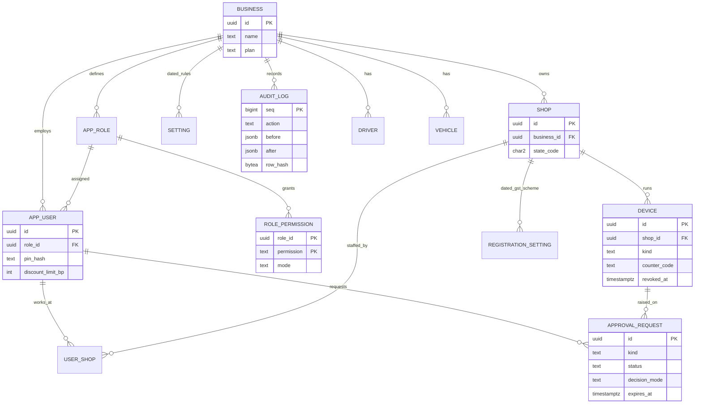

### 7.2 Catalogue engine: categories, templates, attributes, dated rules

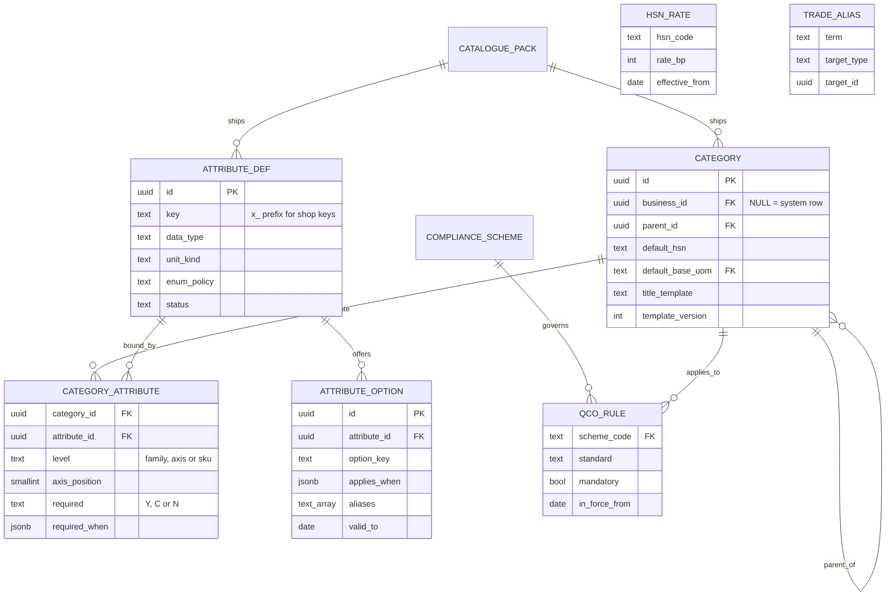

TRADE\_ALIAS points at a category, an attribute option or a family through target\_type and target\_id, so it has no foreign key line; the application checks the target exists. HSN\_RATE is matched by HSN prefix and date, not by a foreign key.

### 7.3 Items: families, variants, units, prices, batches, compliance

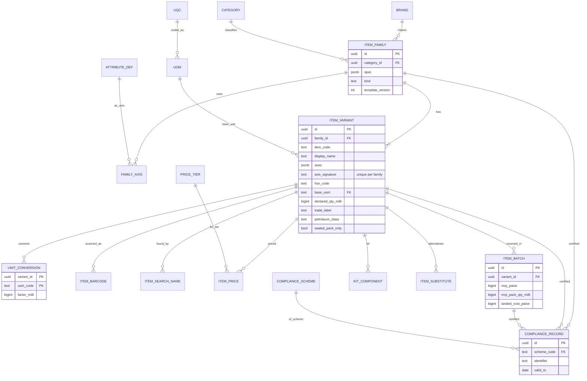

### 7.4 Parties and khata

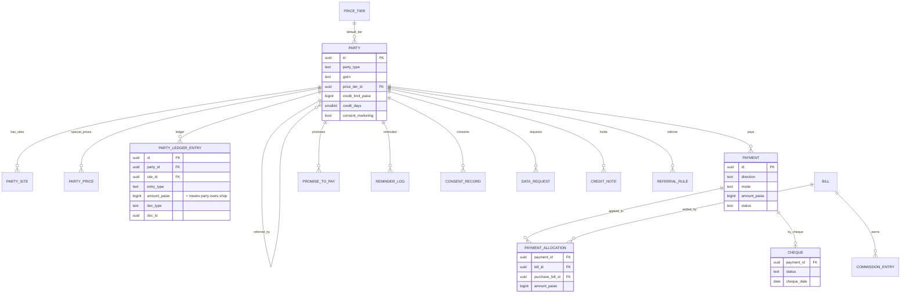

### 7.5 Sales, tinting and delivery

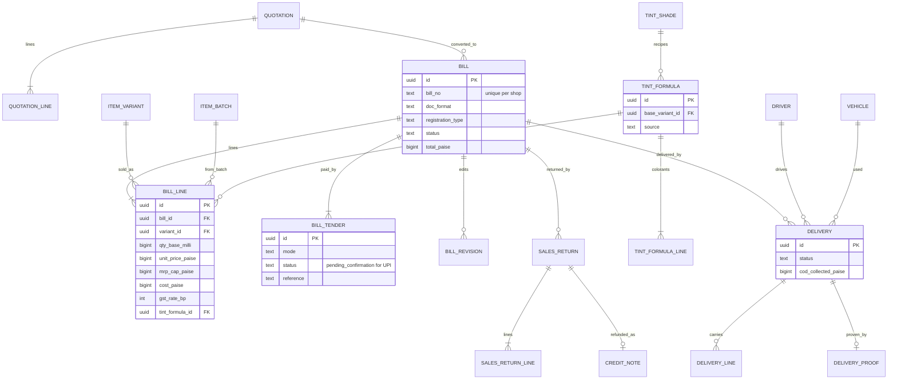

### 7.6 Inventory: movements, balances, rolls, counts, licence

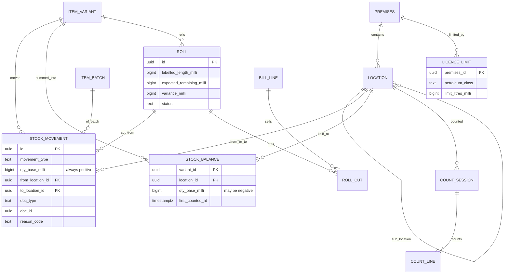

### 7.7 Purchasing and warranty

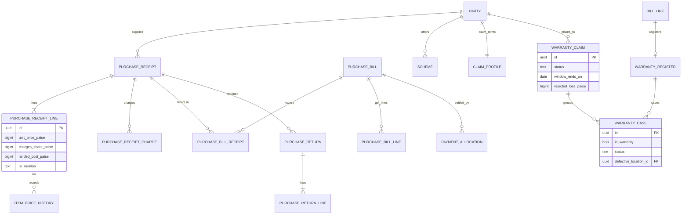

### 7.8 Cash, exceptions, compliance, sync and projections

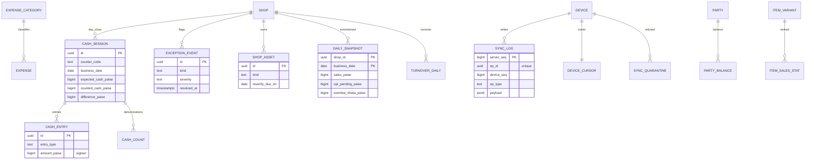

## 8. Database schema (PostgreSQL 16)

The schema has 113 tables, 376 foreign keys and 189 check constraints in about 1,700 lines of DDL, and it runs clean on PostgreSQL 16. The complete script is attached to this conversation as shopos\_schema.sql (six files in dependency order). This section explains it and quotes the tables that carry the design. Devices use the same table and column names in SQLite; only the type mapping below differs.

### 8.1 Conventions

| Topic | Rule |
| --- | --- |
| Keys | uuid primary keys made on the device (UUIDv7, time-ordered so indexes stay compact) |
| Money | bigint paise; line total = quantity in thousandths x unit price per base unit / 1000, rounded half-up once per line |
| Quantity | bigint thousandths of the base unit; always stored in the base unit |
| Tax rate | integer basis points (1800 = 18%) |
| Enums | text plus CHECK, so the same definitions work in SQLite and migrations stay simple |
| Tenancy | business\_id on every tenant table; shop\_id where a record belongs to a shop; row-level security enforces it |
| System rows | Catalogue master tables allow business\_id NULL for rows shipped in a pack; everyone reads them, no tenant can write them |
| Append-only | stock\_movement, party\_ledger\_entry, cash\_entry, audit\_log, sync\_log: triggers reject UPDATE and DELETE, and the application role has no UPDATE right |
| No deletes | The application role has no DELETE right on any table (FR-CMP-008); cancellation is a status, merging is a pointer |
| SQLite mapping | uuid and text as TEXT, bigint and integer as INTEGER, boolean as INTEGER 0 or 1, timestamptz as INTEGER epoch milliseconds, jsonb as TEXT (JSON1), text array as JSON text |

### 8.2 Data dictionary

| Module | Tables |
| --- | --- |
| Tenancy and control (14) | business, shop, app\_role, role\_permission, app\_user, user\_shop, device, driver, vehicle, setting, registration\_setting, approval\_request, audit\_log, plus the audit hash-chain function |
| Catalogue engine (11) | uqc, uom, catalogue\_pack, category, attribute\_def, attribute\_option, category\_attribute, hsn\_rate, compliance\_scheme, qco\_rule, trade\_alias |
| Items (14) | brand, price\_tier, item\_family, family\_axis, item\_variant, item\_barcode, item\_search\_name, unit\_conversion, item\_price, item\_batch, compliance\_record, kit\_component, item\_substitute, item\_note, item\_merge\_log |
| Locations, parties, tinting (13) | premises, location, party, party\_site, party\_price, consent\_record, data\_request, tint\_shade, tint\_formula, tint\_formula\_line, tint\_charge\_rule |
| Sales and delivery (14) | number\_series, quotation, quotation\_line, bill, bill\_revision, bill\_line, bill\_tender, sales\_return, sales\_return\_line, credit\_note, delivery\_rate, delivery, delivery\_line, delivery\_proof |
| Khata (10) | party\_ledger\_entry, payment, cheque, promise\_to\_pay, reminder\_log, referral\_rule, commission\_entry, bank\_import, bank\_txn, payment\_allocation |
| Stock (8) | stock\_movement, stock\_balance, roll, roll\_cut, count\_session, count\_line, unmet\_demand, licence\_limit |
| Purchasing and warranty (13) | purchase\_receipt, purchase\_receipt\_line, purchase\_receipt\_charge, purchase\_bill, purchase\_bill\_receipt, purchase\_bill\_line, purchase\_return, purchase\_return\_line, item\_price\_history, scheme, warranty\_register, claim\_profile, warranty\_claim, warranty\_case |
| Cash, compliance, reports (9) | cash\_session, cash\_count, cash\_entry, expense\_category, expense, exception\_event, shop\_asset, problem\_report, export\_job |
| Sync (4) | sync\_log, device\_cursor, sync\_quarantine, sync\_conflict |
| Projections (4) | party\_balance, daily\_snapshot, item\_sales\_stat, turnover\_daily, plus stock\_balance under Stock |

Projection tables hold nothing that cannot be recomputed. A nightly reconciliation job compares stock\_balance with the sum of stock\_movement and party\_balance with the sum of party\_ledger\_entry, and raises an exception if they differ.

### 8.3 What the database itself enforces

These rules hold even if an application bug tries to break them. Each was tested on PostgreSQL 16 (section 8.7).

| Rule | Mechanism |
| --- | --- |
| One variant per axis combination in a family | UNIQUE (family\_id, axis\_signature) |
| Shop-defined attribute keys cannot collide with system keys | CHECK that a key starts with x\_ exactly when business\_id is set |
| An axis position is used once per category and the axis flag matches | CHECK plus a partial unique index on category\_attribute |
| A conditional requirement carries its condition | CHECK (required <> 'C' OR required\_when IS NOT NULL) |
| Stock history cannot be altered | Trigger forbids UPDATE and DELETE on stock\_movement; reversing movements are used instead |
| A movement has quantity above zero and at least one location | CHECKs; an adjustment must carry a reason (FR-STK-006) |
| Bill totals add up | CHECK total = taxable + CGST + SGST + IGST + round-off |
| A Bill of Supply shows no tax; composition bills carry no IGST | CHECKs on bill (FR-CMP-001, FR-CMP-015) |
| No line above the MRP cap | CHECK unit\_price <= mrp\_cap on bill\_line (FR-BIL-006) |
| A return without a bill needs an approval | CHECK on sales\_return (FR-BIL-019) |
| Bill numbers never repeat in a shop | UNIQUE (shop\_id, bill\_no) |
| One UPI reference is used once per business | Partial unique index on bill\_tender (fake-screenshot guard) |
| The audit trail cannot be rewritten | Append-only trigger plus a per-business hash chain |
| Tenants cannot see or write each other's rows | Row-level security, forced, failing closed when no tenant is set |
| Dated tax rate in force | hsn\_rate lookup by HSN prefix and date; tested with LED lamps (12% before 22 Sep 2025, 18% after) |

### 8.4 Key DDL: the item variant and the catalogue engine

```sql
CREATE TABLE attribute_def (
  id              uuid PRIMARY KEY,
  business_id     uuid REFERENCES business(id),      -- NULL = system row from a pack
  pack_id         uuid REFERENCES catalogue_pack(id),
  key             text NOT NULL,                     -- shop-defined keys must start with x_
  label           text NOT NULL,
  data_type       text NOT NULL CHECK (data_type IN ('enum','int','decimal','measure','text','bool','date')),
  unit_kind       text,                              -- for measure: length_mm, area_sqmm, current_a ...
  min_value_milli bigint,
  max_value_milli bigint,
  step_milli      bigint CHECK (step_milli IS NULL OR step_milli > 0),
  enum_policy     text NOT NULL DEFAULT 'extensible' CHECK (enum_policy IN ('locked','extensible','open')),
  status          text NOT NULL DEFAULT 'unverified' CHECK (status IN ('verified','unverified','inferred')),
  source_ref      text,
  UNIQUE NULLS NOT DISTINCT (business_id, key),
  CHECK ((business_id IS NOT NULL) = (key LIKE 'x\_%' ESCAPE '\')),
  CHECK (data_type <> 'measure' OR unit_kind IS NOT NULL)
);

CREATE TABLE category_attribute (               -- the template: which attributes a category uses
  id             uuid PRIMARY KEY,
  business_id    uuid REFERENCES business(id),
  category_id    uuid NOT NULL REFERENCES category(id),
  attribute_id   uuid NOT NULL REFERENCES attribute_def(id),
  level          text NOT NULL CHECK (level IN ('family','axis','sku')),
  axis_position  smallint CHECK (axis_position BETWEEN 1 AND 4),
  required       text NOT NULL DEFAULT 'N' CHECK (required IN ('Y','C','N')),
  required_when  jsonb,                          -- e.g. {"attr":"material","eq":"HDPE"}
  sort_order     integer NOT NULL DEFAULT 0,
  in_title       boolean NOT NULL DEFAULT false,
  title_order    smallint,
  default_value  jsonb,
  UNIQUE (category_id, attribute_id),
  CHECK ((level = 'axis') = (axis_position IS NOT NULL)),
  CHECK (required <> 'C' OR required_when IS NOT NULL)
);

CREATE TABLE item_variant (                      -- child SKU
  id                   uuid PRIMARY KEY,
  business_id          uuid NOT NULL REFERENCES business(id),
  family_id            uuid NOT NULL REFERENCES item_family(id),
  item_code            text NOT NULL,
  display_name         text NOT NULL,            -- generated from the category title template
  axes                 jsonb NOT NULL DEFAULT '{}' CHECK (jsonb_typeof(axes) = 'object'),
  axis_signature       text NOT NULL,            -- canonical, e.g. colour=red|size_sqmm=1.5
  hsn_code             text,                     -- else family, else category default
  gst_rate_override_bp integer CHECK (gst_rate_override_bp BETWEEN 0 AND 10000),
  base_uom             text NOT NULL REFERENCES uom(code),
  allow_decimal        boolean NOT NULL DEFAULT false,
  declared_qty_milli   bigint CHECK (declared_qty_milli > 0),   -- Legal Metrology declared net quantity
  declared_uom         text REFERENCES uom(code),
  trade_label          text,                     -- e.g. "4 L" for a 3.6 L base
  petroleum_class      text NOT NULL DEFAULT 'NA' CHECK (petroleum_class IN ('A','B','C','NA')),
  sealed_pack_only     boolean NOT NULL DEFAULT false,
  -- ... prices, warranty, serial and roll flags, search_text, version columns (see shopos_schema.sql)
  UNIQUE (business_id, item_code),
  UNIQUE (family_id, axis_signature),
  CHECK ((declared_qty_milli IS NULL) = (declared_uom IS NULL)),
  CHECK (NOT sealed_pack_only OR allow_decimal = false)
);
```

### 8.5 Key DDL: ledger and bill

```sql
CREATE TABLE stock_movement (                    -- append-only; stock = sum of movements (FR-STK-001)
  id               uuid PRIMARY KEY,
  business_id      uuid NOT NULL REFERENCES business(id),
  shop_id          uuid NOT NULL REFERENCES shop(id),
  variant_id       uuid NOT NULL REFERENCES item_variant(id),
  batch_id         uuid REFERENCES item_batch(id),
  roll_id          uuid REFERENCES roll(id),
  movement_type    text NOT NULL CHECK (movement_type IN ('opening','purchase','sale','sale_return',
                     'purchase_return','adjustment','damage','warranty_out','warranty_in',
                     'transfer_out','transfer_in','site_return','count_correction')),
  qty_base_milli   bigint NOT NULL CHECK (qty_base_milli > 0),
  from_location_id uuid REFERENCES location(id),    -- NULL when goods come from outside
  to_location_id   uuid REFERENCES location(id),    -- NULL when goods leave
  doc_type         text,
  doc_id           uuid,
  doc_line_id      uuid,
  reason_code      text CHECK (reason_code IN ('damage','theft','count_error','sample','personal_use','tinting_waste','other')),
  approval_id      uuid REFERENCES approval_request(id),
  user_id          uuid NOT NULL REFERENCES app_user(id),
  device_id        uuid NOT NULL REFERENCES device(id),
  occurred_at      timestamptz NOT NULL,
  created_at       timestamptz NOT NULL DEFAULT now(),
  CHECK (from_location_id IS NOT NULL OR to_location_id IS NOT NULL),
  CHECK (from_location_id IS DISTINCT FROM to_location_id),
  CHECK (movement_type <> 'adjustment' OR reason_code IS NOT NULL)
);

CREATE TABLE bill (
  id                    uuid PRIMARY KEY,
  business_id           uuid NOT NULL REFERENCES business(id),
  shop_id               uuid NOT NULL REFERENCES shop(id),
  device_id             uuid NOT NULL REFERENCES device(id),
  counter_code          text NOT NULL,
  bill_no               text NOT NULL,           -- C1/26-27/000123
  doc_format            text NOT NULL CHECK (doc_format IN ('bill_of_supply','tax_invoice')),
  registration_type     text NOT NULL CHECK (registration_type IN ('composition','regular')),
  status                text NOT NULL DEFAULT 'posted' CHECK (status IN ('posted','cancelled')),
  party_id              uuid REFERENCES party(id),
  bill_date             date NOT NULL,
  billed_at             timestamptz NOT NULL,
  place_of_supply_state char(2) NOT NULL,
  subtotal_paise        bigint NOT NULL,
  taxable_paise         bigint NOT NULL,
  cgst_paise            bigint NOT NULL DEFAULT 0,
  sgst_paise            bigint NOT NULL DEFAULT 0,
  igst_paise            bigint NOT NULL DEFAULT 0,
  round_off_paise       bigint NOT NULL DEFAULT 0,
  total_paise           bigint NOT NULL,
  totals_verified       boolean,                 -- NULL until the server recomputes with shopos_core
  -- ... discount, quotation link, cancellation fields, version (see shopos_schema.sql)
  UNIQUE (shop_id, bill_no),
  CHECK (total_paise = taxable_paise + cgst_paise + sgst_paise + igst_paise + round_off_paise),
  CHECK (doc_format <> 'bill_of_supply' OR (cgst_paise = 0 AND sgst_paise = 0 AND igst_paise = 0)),
  CHECK (registration_type = 'regular' OR igst_paise = 0),
  CHECK ((status = 'cancelled') = (cancelled_at IS NOT NULL))
);
```

### 8.6 Indexes, row-level security, growth

- **Indexes.** 196 in all, including keys; the extra ones follow the query patterns: variant by family and by name, JSON containment on item axes and family specification for admin filters, HSN rate lookup by code and date descending, bills by shop and date, partial indexes for pending UPI, open approvals, open exceptions, open rolls and open promises.
- **Row-level security.** Every table with business\_id has a forced policy. The application connects as a non-owner role and sets app.business\_id at the start of each transaction; if it is not set, no rows are visible. Catalogue tables with a nullable business\_id let all tenants read system rows and write only their own.
- **Growth.** At the section 2 estimate (31 million rows in 10 years for one shop) no partitioning is needed. When shops share the database at pilot scale, hash-partition stock\_movement, party\_ledger\_entry, bill\_line, audit\_log and sync\_log by business\_id; the keys already contain it. I have not benchmarked this, so it is a trigger to test, not a promise.
- **Audit chain cost.** The hash chain serialises audit writes per business with an advisory lock; at 16 rows per bill that is cheap at one shop and worth re-measuring at pilot scale.

### 8.7 Verification run

I applied the six files to a clean PostgreSQL 16 instance and ran the checks below. All behaved as designed.

| Check | Result |
| --- | --- |
| Full schema applies without error | Passed: 113 tables |
| Duplicate axis combination in a family | Rejected |
| Shop attribute key without x\_ prefix | Rejected |
| UPDATE and DELETE on stock\_movement and audit\_log | Rejected by trigger |
| Adjustment without a reason; movement with no location | Rejected |
| Bill whose total does not add up; tax on a Bill of Supply | Rejected |
| Duplicate bill number in a shop | Rejected |
| Bill line priced above its MRP cap | Rejected |
| Audit rows chain to the previous row's hash | Passed |
| LED lamp rate on 1 Sep 2025 and 1 Oct 2025 | 12% then 18% |
| No tenant set, tenant A and tenant B reads | 0 rows; own rows only; system catalogue rows visible to both |
| Tenant B writing tenant A's row, or a system row | Rejected by row-level security |
| Application role deleting a bill or updating a stock movement | Permission denied |
| Stock balance projection built from movements | Passed |

Not tested: performance under load, the SQLite copy, and the sync handlers. Those are the next things to build and measure.

## 9. API design

The counter never calls the server to complete a sale, so the API is small. Most traffic is one pair of endpoints (push and pull); the rest is registration, catalogue packs, owner queries and admin. REST over HTTPS, JSON, versioned under /v1. I chose plain REST with a cursor protocol over gRPC or GraphQL because it is easy to debug on a shop's flaky network, easy to proxy, and the sync payload is already a log of operations rather than a graph of resources.

### 9.1 Conventions

| Topic | Rule |
| --- | --- |
| Versioning | Path prefix /v1. Additive changes only inside a version; the app sends its schema version and the server refuses a push from a client too old to be understood (HTTP 426) |
| Auth | Device registration with a one-time code gives an opaque device token (stored in the OS keystore). The device exchanges it for a 15-minute JWT carrying business\_id, shop\_id, device\_id and role. PINs never leave the device; they unlock local data and authorise operations locally |
| Authorisation | The server re-checks role permissions against the user stated in each operation, because a device can be stolen or modified |
| Idempotency | Every write carries an Idempotency-Key header; sync operations are idempotent by op\_id, so retrying any number of times is safe |
| Errors | RFC 7807 problem+json with a stable code field (for example DEVICE\_REVOKED, SCHEMA\_TOO\_OLD, OP\_REJECTED) |
| Pagination | Opaque cursors, never offsets |
| Rate limits | Per device, generous for sync, strict for registration and login-style calls |
| Time | ISO 8601 UTC on the wire; devices also send their hybrid logical clock |
| Compression | gzip on request and response bodies |

### 9.2 Endpoint list

| Group | Method and path | Purpose |
| --- | --- | --- |
| Registration | POST /v1/devices/register | Exchange a one-time code (made by the owner) for a device token; the server returns the counter code and the last used bill number for that counter, so a restored device never repeats a number |
|  | POST /v1/auth/token | Device token to short-lived JWT |
|  | POST /v1/devices/{id}/revoke | Owner revokes a lost device; its token stops working at once |
| Sync | POST /v1/sync/push | Send a batch of operations from the device outbox |
|  | GET /v1/sync/pull?cursor= | Fetch operations from other devices and server-made changes after the cursor |
|  | POST /v1/sync/snapshot | Full bootstrap for a new or restored device (masters plus 24 months of history) |
| Catalogue | GET /v1/catalogue/packs?since= | List catalogue pack versions newer than the device has |
|  | GET /v1/catalogue/packs/{id}/{version} | Download a pack (categories, attributes, options, HSN rates, compliance rules) |
|  | POST /v1/catalogue/extensions | Propose a shop-specific attribute, option or alias for review |
| Owner queries | GET /v1/reports/daily?shop=&date= | Daily snapshot (sales, cash, khata, stock value) |
|  | GET /v1/reports/ageing?shop= | Receivables ageing by party |
|  | GET /v1/reports/stock?shop= | Stock position and slow movers |
|  | GET /v1/audit?entity=&id= | Change history for a record |
| Approvals | POST /v1/approvals; POST /v1/approvals/{id}/decide | Remote approval from the owner's phone for a discount, return or credit override |
| Files | POST /v1/files/presign | Short-lived upload link for photos (delivery proof, item photos, supplier bills) |
| Admin | GET /v1/admin/exceptions; POST /v1/admin/exports | Exception list and data export jobs |
| Health | GET /healthz, GET /readyz | Liveness and readiness (database reachable, migrations current) |

### 9.3 The sync protocol

The protocol is the heart of the API, so it is written out in full.

**Push.** The device sends operations in device\_seq order, at most 200 per request. The server accepts each in its own savepoint so one bad operation cannot block the others.

```http
POST /v1/sync/push
Authorization: Bearer <jwt>
Idempotency-Key: 0192f6a0-7b1e-7c3a-9d52-4f2e8a1b6c10
Content-Encoding: gzip

{
  "device_id": "0192f5f1-...",
  "schema_v": 14,
  "ops": [
    {
      "op_id": "0192f6a0-7b1e-7c3a-9d52-4f2e8a1b6c11",
      "device_seq": 8841,
      "hlc": "2026-11-13T10:42:07.120Z-0003-0192f5f1",
      "op_type": "bill.post",
      "entity_id": "0192f6a0-7b1e-7c3a-9d52-4f2e8a1b6c20",
      "payload": {
        "bill": { "bill_no": "C1/26-27/000123", "total_paise": 236000, "...": "..." },
        "lines": [ { "variant_id": "...", "qty_base_milli": 2000, "unit_price_paise": 8500 } ],
        "tenders": [ { "mode": "upi", "amount_paise": 236000, "upi_ref": "4231..." } ],
        "movements": [ { "movement_type": "sale", "qty_base_milli": 2000 } ],
        "ledger": []
      }
    }
  ]
}
```

```http
HTTP/1.1 200 OK

{
  "results": [
    { "op_id": "0192f6a0-...11", "status": "applied", "server_seq": 5120331 },
    { "op_id": "0192f6a0-...12", "status": "duplicate", "server_seq": 5120298 },
    { "op_id": "0192f6a0-...13", "status": "rejected", "code": "UPI_REF_REUSED", "detail": "..." }
  ],
  "ack_through_device_seq": 8843
}
```

| Status | Meaning | What the device does |
| --- | --- | --- |
| applied | New operation accepted; the server gave it a server\_seq | Marks it sent |
| duplicate | Seen before (same op\_id) | Treats as sent; this is the normal result of a retry after a lost response |
| rejected | Violates a rule the server enforces (for example a reused UPI reference or a role the user lacks) | Keeps the bill (it is a legal record), flags it in the exception list and notifies the owner; nothing is silently dropped |
| conflict | Master data edit lost a field-level comparison on a money field | Keeps both values and raises a sync\_conflict for the owner to resolve |

The server writes the operation, its derived rows and the sync\_log entry in one PostgreSQL transaction, so a crash leaves either all of it or none of it.

**Pull.** The device asks for everything after its cursor, which is a server\_seq value stored per device in device\_cursor.

```http
GET /v1/sync/pull?cursor=5120331&limit=500

{
  "ops": [ { "server_seq": 5120332, "device_id": "...", "op_type": "stock.adjust", "payload": { } } ],
  "next_cursor": 5120420,
  "has_more": false,
  "server_time": "2026-11-13T10:42:09Z"
}
```

The device applies pulled operations in server\_seq order inside one SQLite transaction and advances its cursor in the same transaction, so an interruption is safe. Operations made by the pulling device itself are skipped. A device whose cursor is older than the retained log is told to take a snapshot instead (409 CURSOR\_EXPIRED).

**Order of operations on a reconnect.** Push first, then pull. Pushing first means the server holds this device's latest facts before the device applies anyone else's, which keeps derived balances consistent.

### 9.4 Operation types

| Family | op\_type values | Conflict handling |
| --- | --- | --- |
| Sales | bill.post, bill.cancel, return.post, quotation.save, delivery.update | Append-only facts: no conflict, only validation |
| Stock | stock.adjust, count.submit, roll.cut, transfer.send, transfer.receive | Append-only movements; balances are recomputed |
| Khata | payment.receive, ledger.adjust, promise.set | Append-only entries; balance is a sum |
| Purchasing | receipt.post, purchase\_bill.post, purchase\_return.post | Append-only; landed cost allocated on the server and in the shared core |
| Cash | cash.open, cash.entry, cash.close | Append-only; closing records the expected figure computed by shopos\_core |
| Master data | party.upsert, item.upsert, price.set | Field-level last-writer-wins by HLC; a differing money field raises a sync\_conflict |
| Control | approval.request, approval.decide | Single-use; a second decision is rejected |

### 9.5 Server-side validation on push

The server does not trust the device, even though the device is the author of the sale. It re-runs shopos\_core (the same TypeScript code) on each bill and checks:

- totals and tax recomputed from lines match the stated totals (result stored in bill.totals\_verified; a mismatch is flagged, not rejected, because the customer already has the paper);
- the user had the permission for that operation at the time, using the role snapshot synced with the operation;
- a discount above the user's limit carries an approval id that exists and was decided;
- the bill number belongs to that device's series and is not already used;
- UPI references, cheque numbers and similar tokens are not reused;
- movements reference real variants and locations of the business.

A failed check produces an exception\_event for the owner rather than losing the record. The principle is that a legal sale that already happened is always stored; the system's job is to notice and report problems, not to undo the sale.

### 9.6 Catalogue pack delivery

Devices fetch packs with a version number. A pack is a signed YAML bundle validated in CI. The device applies it in one transaction after checking the pack's minimum client version. Items keep the template version they were made under (template\_version), so a new pack version never silently rewrites existing items; the admin screen offers a migration step that previews what would change. Shop extensions (x\_ attributes and shop-only options) travel through the normal sync, so they stay separate from the system pack and survive pack upgrades.

### 9.7 Owner query API

The owner's phone mostly reads its own local copy, but the server serves reports that need the whole shop (for example when the owner has been offline). Each report reads the projection tables, which are cheap, and returns the as-of timestamp of the last sync from each counter, so the owner can see how fresh the numbers are. If a counter has not synced for more than a set time, the response says so instead of presenting partial figures as complete.

### 9.8 Errors and limits

| HTTP | Code | When |
| --- | --- | --- |
| 400 | VALIDATION | Malformed request or payload that fails the schema |
| 401 | TOKEN\_EXPIRED | JWT expired; the device refreshes and retries |
| 403 | DEVICE\_REVOKED | The owner revoked this device; the app locks and shows the reason |
| 409 | CURSOR\_EXPIRED | Pull cursor older than the retained log; take a snapshot |
| 413 | BATCH\_TOO\_LARGE | More than 200 operations or above the size limit |
| 426 | SCHEMA\_TOO\_OLD | App must be updated before it can sync |
| 429 | RATE\_LIMITED | Retry-After header gives the wait |
| 503 | MAINTENANCE | Server is restarting or restoring; the device keeps working offline and retries with backoff |

The device retries with exponential backoff and jitter. A 5xx or a network error never stops billing; the outbox simply grows until the link returns.

## 10. Low-level design: classes and patterns

The code is split so that everything that decides money, tax, stock and catalogue validity is pure TypeScript with no I/O, in one package (shopos\_core) that the Electron app, the React Native app and the server all import. A rule is then written once, tested once, and gives the same answer on the counter and on the server. Everything that touches SQLite, PostgreSQL, the network or the printer sits behind an interface.

### 10.1 Package layout

| Package | Contains | Depends on |
| --- | --- | --- |
| shopos\_core | Money, Quantity, Uom, PricingEngine, TaxEngine, RuleEngine, CatalogueEngine, TitleRenderer, ConditionEvaluator, domain aggregates (Bill, StockLedger, PartyLedger), domain events | nothing (pure TypeScript, no Node, DOM or React Native imports) |
| shopos\_app | Use cases (PostBill, ReceivePayment, CutRoll...), ports (repositories, printer, clock), sync client, UI-independent state; no screens | shopos\_core |
| shopos\_data\_local | SQLite repositories (Drizzle or Kysely), outbox writer, SQLCipher setup, one driver adapter per platform | shopos\_core, shopos\_app ports |
| shopos\_ui\_desktop | Electron main process (hosts SQLite, printing, auto-update) and React renderer for the counter | shopos\_app, shopos\_data\_local |
| shopos\_ui\_mobile | React Native app for Owner, Godown and the tablet counter | shopos\_app, shopos\_data\_local |
| shopos\_server | NestJS handlers, sync service, PostgreSQL repositories, jobs, auth | shopos\_core |
| shopos\_catalogue\_packs | YAML packs, CI validator (uses CatalogueEngine) | shopos\_core |

Dependencies point inward only: UI and data packages depend on core, never the reverse. A test in CI fails the build if shopos\_core imports anything outside the language built-ins (an ESLint rule blocks Node, DOM and React Native imports there).

**Two client shells, one body of logic.** Everything except the screens and the hardware is shared, so the two shells stay thin.

- **Desktop counter (Electron).** The main process owns the encrypted SQLite file (a native SQLite binding with SQLCipher) and the printer; the React window talks to it over IPC. Thermal printers go through ESC/POS over USB or the network from the main process; A4 invoices go through PDF generation. Most barcode scanners act as a keyboard, so scanning needs no driver. The key is kept with Electron safeStorage.
- **Phones and tablet (React Native).** SQLite with SQLCipher through a native module, the key in the Android Keystore, Bluetooth ESC/POS for a portable printer, the camera for scanning and delivery proof, FCM for approval pushes.
- **Shared.** shopos\_core, use cases, repositories behind ports, the sync client and the design tokens. A screen only calls a use case and renders the result.
- **Money in TypeScript.** Paise and quantities in thousandths are integers held as JavaScript numbers, which are exact far beyond any shop's totals (about 9 x 10^15). PostgreSQL returns bigint as text, so the server maps it explicitly, and a lint rule bans floating-point arithmetic in shopos\_core.

Library names here (SQLite driver, ESC/POS package, Bluetooth printing) are my starting choices, not tested; the first spike should prove SQLCipher and printing on the target Windows PC, an Android phone and the tablet before the rest is built.

### 10.2 Core value objects and calculation

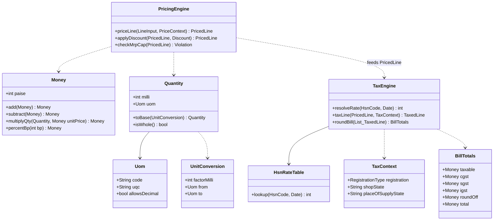

Why these shapes. Money and Quantity are immutable value objects over integers, so there is no floating point anywhere in the money path. Rounding happens in exactly one place (per line, half-up), and the tax engine takes the registration type and place of supply from a context object so that composition shops, regular shops and inter-state sales are one code path with different inputs, not three code paths.

### 10.3 Catalogue engine

The engine reads the catalogue as data: a template says which attributes a category uses, and the engine validates items against it, builds the variant signature and renders the display name. Adding a category, attribute or option is a data change, never a code change.

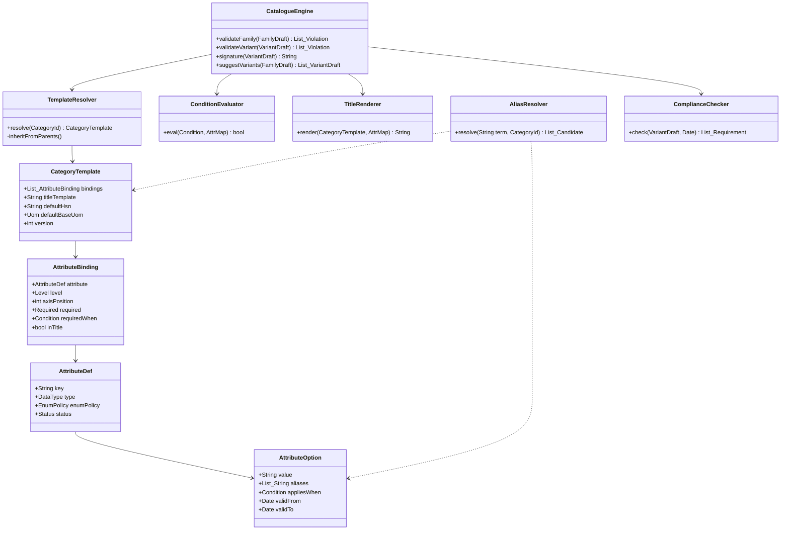

How the three requirements of the catalogue are met.

| Requirement | How the design meets it |
| --- | --- |
| Scalable | Items are one family row plus variant rows, so a hundred sizes of one cable are one family. Hot filters use typed columns and indexes; rare attributes sit in JSONB. Lookup by barcode, code or name uses indexed search columns on the device, so billing stays fast with tens of thousands of variants |
| Extensible | A new product line is a new category with bindings (attributes plus levels). A new attribute is a row. A new option is a row. Shops add x\_ attributes and options without touching system data. Template inheritance means a child category only states what differs |
| Maintainable | Catalogue content lives in versioned YAML packs reviewed in pull requests and validated in CI by the same engine the app uses. Each attribute has a status (verified, unverified, inferred) so unsure research is visible as such. Items record the template version they were made under, so an upgrade is a previewed migration, never a silent rewrite |

### 10.4 Domain aggregates: billing, stock, khata

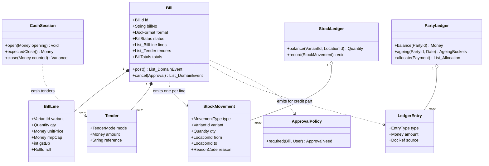

A Bill is posted once and never edited. Posting returns domain events (StockMoved, LedgerEntryAdded, CashTendered) that the data layer persists in the same transaction as the bill. Cancelling does not delete; it creates reversing movements and entries and sets the status. This is what makes the append-only database rules and the aggregate agree.

### 10.5 Application layer: use cases, ports and adapters

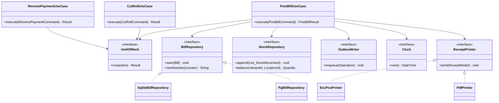

The same use-case classes run on the device (with SQLite adapters) and in tests (with in-memory adapters). On the server, the sync handler does not re-run PostBill; it validates the operation and stores its rows through the PostgreSQL repositories, using shopos\_core only to recompute and compare totals.

### 10.6 Sync and control

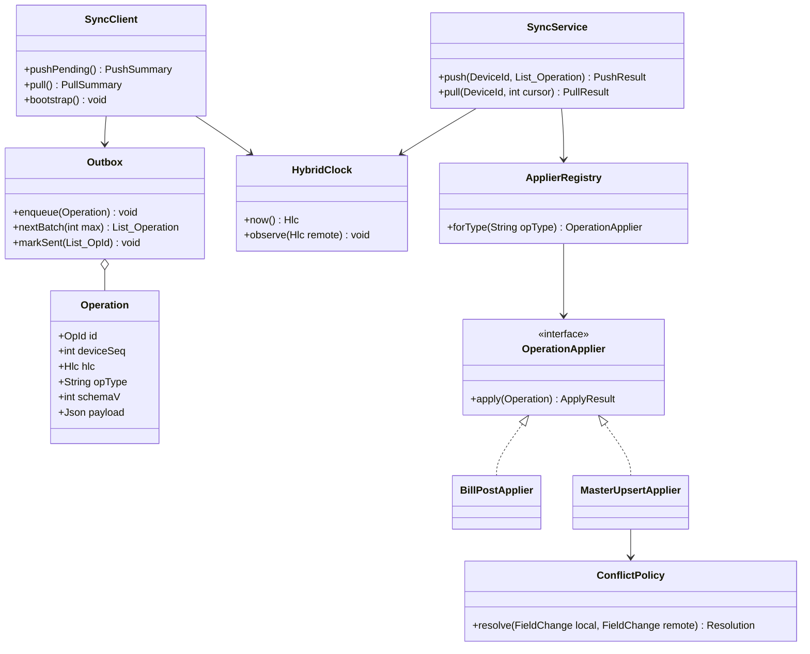

Adding a new kind of operation means writing one applier class and registering it; the push and pull code does not change.

### 10.7 Design patterns used, and where I deliberately did not

| Pattern | Where | Why |
| --- | --- | --- |
| Value object | Money, Quantity, Hlc, ids | Makes unit and rounding mistakes impossible to type by accident |
| Aggregate | Bill (with lines and tenders); each ledger | One consistency boundary equals one database transaction |
| Repository and unit of work | Data access behind interfaces | Same use case runs on SQLite, PostgreSQL and in memory |
| Ports and adapters | Printer, clock, file storage, WhatsApp share, UPI check | Hardware and vendors change; the core does not |
| Strategy | Pricing rules, tax context (composition or regular), rounding, landed-cost allocation (by value, quantity or weight) | A rule that varies by shop setting is an object, not an if chain |
| Registry (command dispatch) | ApplierRegistry for sync operation types | Open for new operation types, closed for the sync loop |
| Template method | Document posting steps (validate, price, tax, emit events) shared by Bill, Return, Quotation | One order of steps, differences in hooks |
| State machine | Bill, delivery, cheque, approval, roll, warranty case (see section 11) | Illegal transitions become compile or test failures |
| Specification | Approval policy and discount limits as small combinable rules | Owner-configurable without code changes |
| Event (domain events) | Aggregates return events; the data layer stores them with the outbox | Keeps projections and sync consistent without hidden side effects |

Not used, on purpose: a generic plugin framework, dependency-injection containers beyond simple constructor wiring, an event bus, CQRS read stores and an abstract factory zoo. None has a problem to solve at this size. The one extension point that does need to be open (new catalogue content) is handled with data, not class hierarchies.

### 10.8 SOLID in practice

- **Single responsibility.** PricingEngine prices, TaxEngine taxes, CatalogueEngine validates; none knows about storage.
- **Open and closed.** New operation type, new tender mode, new category or new compliance scheme are added without editing existing classes (applier, enum plus strategy, data row, data row).
- **Liskov.** Every repository adapter passes the same contract test suite, so the in-memory, SQLite and PostgreSQL versions are interchangeable.
- **Interface segregation.** Use cases depend on small ports (StockRepository, OutboxWriter), not on one large database object.
- **Dependency inversion.** shopos\_core defines the ports it needs; outer packages implement them.

## 11. Low-level design: flows, algorithms and state machines

### 11.1 Posting a bill (the most important flow)

Everything below happens on the counter device with no network. The sale is complete when the local transaction commits.

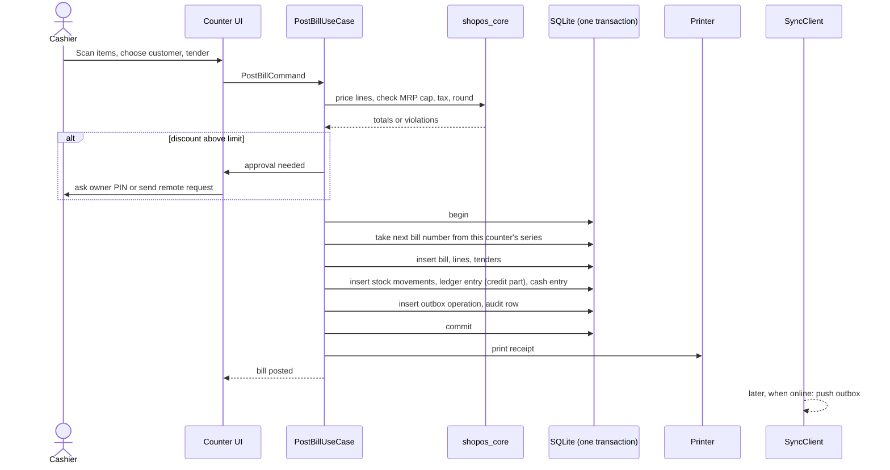

Why one transaction: a bill without its stock movements or its outbox entry would break stock or lose the sale in sync. SQLite commits all of it or none of it, and a power cut mid-sale leaves no half bill. Printing is after commit and may fail without affecting the record; the receipt can be reprinted.

**Pricing and tax steps, in order (in shopos\_core).**

1. Convert the entered quantity to the base unit (quantity in thousandths).
2. Take the unit price from the first match: party price, price tier, item price. All prices are per base unit.
3. Line amount = quantity in thousandths x unit price / 1000, rounded half-up once.
4. Apply a line or bill discount (a bill discount is spread across lines in proportion to line amount, the last line takes the remainder so the parts add up exactly).
5. Reject any line priced above its MRP cap (FR-BIL-006).
6. Resolve the tax rate from the HSN code and the bill date (dated lookup, longest HSN prefix wins).
7. Tax: if the shop is a composition dealer or the bill is a Bill of Supply, tax is zero and the format is Bill of Supply. Otherwise split into CGST and SGST (same state) or IGST (other state).
8. Total = taxable + taxes, then round to the nearest rupee; the difference is stored as round-off.

Assumption to confirm against the PRD: retail prices are tax-inclusive by default, so taxable value = gross x 10000 / (10000 + rate in basis points), rounded once per line. If a shop prices tax-extra, a setting switches the order and nothing else changes.

### 11.2 Bill, delivery and approval state machines

```mermaid
stateDiagram-v2
  [*] --> Draft
  Draft --> Posted: post (stock, ledger, cash written)
  Draft --> [*]: discard (nothing was written)
  Posted --> Cancelled: cancel with approval and reason (reversing rows written)
  Posted --> Posted: return posted as separate document
  Cancelled --> [*]
```

A posted bill is never edited. A return is its own document (sales\_return with credit note) so the original bill stays as printed.

```mermaid
stateDiagram-v2
  [*] --> Requested
  Requested --> Approved: owner decides yes
  Requested --> Rejected: owner decides no
  Requested --> Expired: time limit passes
  Approved --> Consumed: used by exactly one operation
  Approved --> Expired: unused past limit
  Consumed --> [*]
  Rejected --> [*]
  Expired --> [*]
```

An approval is single-use: it names the exact bill and amount it allows, so a cashier cannot reuse one approval for a bigger discount.

```mermaid
stateDiagram-v2
  [*] --> Planned
  Planned --> Loaded: goods loaded on vehicle
  Loaded --> OutForDelivery: driver leaves
  OutForDelivery --> Delivered: proof captured (photo, signature or OTP)
  OutForDelivery --> Failed: customer unavailable or refused
  Failed --> Planned: reschedule
  Failed --> Returned: goods back to shop (site_return movement)
  Delivered --> [*]
  Returned --> [*]
```

### 11.3 Stock: balances and projections

- Stock of a variant at a location = sum of movements into the location minus sum out of it. The stock\_balance table is a cache of that sum, updated in the same transaction as the movement on the device, and rebuilt from movements whenever the nightly check finds a difference.
- A movement is always positive; its direction comes from the from and to locations. A transfer is two linked movements (transfer\_out then transfer\_in) so goods in transit are visible as stock at a transit location rather than disappearing.
- Negative stock is allowed only if the shop setting says so (many shops sell before the purchase bill is entered). When it happens the sale is not blocked, an exception is raised, and the counter shows a banner for the owner.
- A stock count (count\_session) compares counted quantity with the book quantity at the count's start time and writes count\_correction movements for the difference, so an adjustment always has a documented source and reason.

### 11.4 Purchase and landed cost

When goods arrive, charges that were not on the item lines (freight, loading, insurance) are spread over the lines so each item carries its true cost.

1. Choose the allocation basis per charge: by value (default), by quantity or by weight.
2. Share of a line = charge x basis of line / total basis of all lines, in paise, rounded down.
3. The remainder (at most a few paise) goes to the line with the largest basis, so the shares add up exactly to the charge.
4. Landed unit cost = (line value + shares) / quantity, stored in item\_price\_history so margins in reports use real cost.

The purchase bill from the supplier can arrive after the goods. Receipts and bills are separate documents linked in purchase\_bill\_receipt, so a mismatch between what arrived and what was billed is visible instead of hidden.

### 11.5 Khata: balances, ageing and payment allocation

- A party's balance is the sum of ledger entries: sales on credit and debit notes add, payments and credit notes subtract.
- **Allocation.** A payment received is matched to open invoices oldest first by default (the owner can pick specific invoices). The result is rows in payment\_allocation, so ageing stays correct without rewriting bills.
- **Ageing buckets.** Open amount per invoice is grouped by days since the bill date: 0 to 30, 31 to 60, 61 to 90, over 90 (the cut points are a setting).
- **Reminders and promises.** A promise-to-pay stores the date and amount. A daily job lists broken promises; the reminder log records what was sent and when, so the owner is not pestered twice for the same thing.
- **Credit limit.** Checked when posting a credit sale. Exceeding it needs approval, and the approval id is stored on the bill.

### 11.6 Roll goods: cutting and closing rolls (wire, pipe, cable, hose)

Some items are sold by length from a roll. A roll has an original length and a remaining length; the roll\_cut table links each cut to the bill line.

1. The cashier enters the length wanted. The system picks the roll to cut from: the open roll with the least remaining that still covers the length (to finish old rolls first); if none covers it, it offers to join pieces from two rolls only when the item allows it.
2. A cut writes a sale movement against that roll and reduces remaining length.
3. When remaining falls below the item's remnant threshold, the roll is marked closed and the leftover is recorded as a remnant (sellable at a different price) or as wastage with a reason.
4. Roll cuts sync as ordinary operations. If two counters cut the same roll while offline and the total exceeds the length, the later operation is accepted (the sale happened), the roll goes slightly negative, and an exception tells the owner to check the physical roll.

### 11.7 Tinting bill (paint)

A tinted paint sale has three parts that must appear together on the bill:

- the base (a normal stock item in a sealed pack),
- the tint formula lines (colourant quantities in millilitres, from tint\_formula, each a stock item so colourant stock reduces),
- the tinting charge (a rule in tint\_charge\_rule by pack size).

The saved formula keeps the shade, base and pack size, so a repeat order for the same shade reproduces the same formula. Because a tinted can cannot be returned, the bill line is flagged non-returnable, and the return flow blocks it (the PRD's no-return rule for tinted paint).

### 11.8 Cash session

```mermaid
stateDiagram-v2
  [*] --> Closed
  Closed --> Open: open with opening cash counted
  Open --> Open: cash sale, payment, refund, expense, drop
  Open --> Counting: owner or cashier starts closing
  Counting --> Closed: counted figure saved with variance
  Counting --> Open: cancel closing
```

Expected cash at closing = opening cash + cash sales + cash payments received from parties + cash received for other reasons, minus cash refunds, minus cash expenses, minus cash drops to the safe or bank. Variance = counted minus expected. The expected figure is computed by shopos\_core and stored with the session, so the same number is shown on the device and in the owner's report. A variance beyond a set limit raises an exception for the owner.

### 11.9 Registration change (composition to regular GST)

The registration type is a dated setting. A bill takes the document format from the setting in force on its bill date, not on the date it syncs. When a shop moves from composition to regular, bills before the effective date stay Bills of Supply and new bills are Tax Invoices. Stock bought earlier keeps its cost, and the owner sees a checklist (HSN codes on all items, GSTIN on business customers, invoice series) before the switch date, because a wrong format cannot be fixed after posting.

### 11.10 Rebuilding projections and nightly reconciliation

1. Read the last reconciled sync position.
2. For each projection (stock\_balance, party\_balance, daily\_snapshot), recompute from the ledgers for changed keys only.
3. Compare with the stored projection. If different, write the correct value, raise an exception\_event with both numbers, and keep the old value in the event for investigation.
4. Run in the shop's quiet hours and never lock billing; it reads committed rows only.

### 11.11 Testing the logic

| Level | What | Why |
| --- | --- | --- |
| Golden tests | A fixed set of bills with hand-checked totals, including tax edge cases (rate change date, composition, inter-state, rounding) | The money path must never change silently |
| Property tests | For random lines and discounts: the parts always add up, no negative tax, rounding stays within bounds, stock never drifts from movements | Finds cases nobody thought of |
| Contract tests | Same suite against in-memory, SQLite and PostgreSQL repositories | Keeps adapters interchangeable |
| Sync simulation | Several fake devices, random offline periods, duplicated and reordered batches; check every device converges and balances match | Offline sync is where bugs hide |
| Catalogue pack CI | Every pack validated by the engine: no duplicate axis signature, every enum used exists, HSN rates have no date gaps | Catalogue content is reviewed like code |
| Restore drill | Wipe a device, restore, verify bill numbers continue without a repeat | Proves the series handshake works |

## 12. Reliability, security, observability and scalability

### 12.1 Failure modes and what happens

| Failure | What the user sees | Design response |
| --- | --- | --- |
| Internet down | Nothing; billing continues | Offline-first; outbox grows; sync resumes with backoff |
| Server down or restoring | A small sync-paused indicator | Same as above; the owner's phone shows data as of the last sync |
| Power cut during a sale | After restart the bill is either complete or absent | One SQLite transaction in WAL mode; no half-written bill |
| Counter PC dies or is stolen | Owner restores on a new device | Registration code, snapshot restore, bill-number handshake (no repeat numbers); the old device is revoked so its token is dead |
| Two counters sell the last unit | Both sales stand; stock goes negative | Append-only movements; an exception is raised; the owner reconciles physically |
| Sync batch contains one bad operation | Owner sees an exception | Per-operation savepoint; good operations still apply; bad one is quarantined with the reason |
| Duplicate or reordered pushes | Nothing | Idempotent by op\_id; pull is by server\_seq |
| Device clock wrong | Odd timestamps | HLC keeps ordering sane; the server records its own receive time; a large skew raises an exception |
| Corrupted local database | App refuses to open the file and offers restore | Integrity check at start; restore from the last server snapshot plus pending outbox if it survived |
| Printer offline | Bill saved; print fails | Reprint any time; printing is outside the transaction |
| Projection drift | None unless the owner reads wrong totals | Nightly reconciliation rewrites projections from ledgers and logs the difference |
| Bad catalogue pack | Pack not applied | CI validation, minimum client version, apply in one transaction, previous pack kept |

The design rule behind the table: a sale that happened is never lost and never blocked by infrastructure; problems are detected afterwards and reported to the owner.

### 12.2 Backup and recovery

| Layer | Method | Target (assumption to confirm with the owner) |
| --- | --- | --- |
| Server database | Continuous WAL archiving to object storage plus a daily base backup | Restore to any minute within 7 days; recovery within a few hours |
| Object storage (photos, files) | Versioned bucket, separate account for backups | Accidental deletion recoverable |
| Devices | Each device is a replica; a lost device is restored from the server | No device holds the only copy once it has synced |
| Restore drill | Quarterly: restore to a scratch instance and compare balances and counts | An untested backup is not a backup |

Section 2 gives the availability goal of 99.5 percent (about 3.6 hours a month). Because shops keep billing offline, server downtime costs the owner fresh reports, not sales, so a single server with tested restore is a fair fit at this stage. I have not measured recovery time, so the first drill sets the real number.

### 12.3 Security

| Area | Control |
| --- | --- |
| Data on device | SQLCipher encryption; the key is held in the OS keystore (Android Keystore, or Electron safeStorage on desktop) and unlocked by the device PIN or biometric |
| Staff PINs | Stored only as Argon2id hashes with salt; lockout after repeated failures; owner can reset |
| Transport | TLS 1.2 or higher on all calls; certificate pinning optional later |
| Devices | One-time registration code; opaque device token; owner can revoke instantly; revoked device locks itself on next contact and, if the owner chooses, wipes local data |
| Authorisation | Role permissions enforced on the device for usability and again on the server for safety (never trust the client) |
| Tenant isolation | business\_id on every row plus PostgreSQL row-level security that fails closed; the app role has no DELETE and no UPDATE on append-only tables |
| Audit | Hash-chained audit\_log per business: any edit or removal of an old row breaks the chain and the nightly check reports it |
| Secrets | Held in the server's secret store, never in the repository or the app |
| Personal data | Consent record per party and data-request workflow for access or erasure (the erasure keeps legal bills; personal fields are pseudonymised, because tax law requires keeping the invoices) |
| Supply chain | Locked dependencies, CI vulnerability scan, signed app releases |
| Fraud signals | Reused UPI reference blocked, below-cost and above-MRP checks, discount and void patterns summarised for the owner as exceptions |

The Digital Personal Data Protection rules and any retention periods under tax law should be confirmed with a lawyer or CA before launch; I am not giving legal advice here.

### 12.4 Observability

- **Logs.** Structured JSON with request id, business id, device id and operation id. No personal data or full payloads in logs.
- **Metrics.** Sync push and pull latency and error rate, outbox age per device (the most useful single health number: a counter whose oldest unsent operation is hours old needs a call), rejected-operation count, projection drift count, database connections, disk and WAL lag.
- **Alerts.** Page on server down, backup not completed, WAL archive lag, disk above a threshold, and error-rate spikes. Ticket-level for a device not synced for more than a day during business hours.
- **Tracing.** Request ids across device and server are enough at this size; add distributed tracing only if a second service appears.
- **Owner-facing health.** A simple screen shows, per counter, the last sync time and the number of unsent operations, so the shop can see its own state without calling support.

### 12.5 Scalability: what changes at 10x and 100x

Numbers use the section 2 estimates; none of this is measured, so each trigger below is a thing to test before relying on it.

| Scale | Expected load (from section 2) | What to do |
| --- | --- | --- |
| 1 to 10 shops | Under about 4 sync rows per second on average | Single VM, one PostgreSQL, nightly jobs inline. Nothing to change |
| 100 shops | About 35 rows per second average, about 350 in a burst | Still one PostgreSQL primary. Add a read replica for owner reports, hash-partition the large ledger tables by business, move heavy jobs to a separate worker process on the same codebase |
| 1,000 shops and more | Roughly ten times the above | Split the sync service from the report service, shard by business across database instances, and revisit the audit hash chain (per-business advisory lock) and per-device snapshot cost |
| Large single shop (many counters, many SKUs) | Device holds masters plus 24 months (about 3 GB) | Tune local indexes, shorten history window, page the catalogue search; the catalogue's family and variant split keeps searches off the full SKU list |

What I would still avoid at 100 shops unless a measurement demands it: Kafka (the sync log table is already an ordered log with cursors), Redis (nothing is cached that SQLite or PostgreSQL cannot serve), Elasticsearch (device search uses local indexes; server search is an admin tool), microservices and Kubernetes (one deployable and one database are easier to run and to restore).

### 12.6 Cost shape

One small VM, one managed or self-run PostgreSQL volume, object storage with versioning, push notifications (free tier), and optional SMS or WhatsApp provider fees if the owner chooses reminders through a provider rather than share links. I have not priced these; get a current quote from the chosen cloud before committing, and expect storage to grow about 1.5 GB per shop per year on the section 2 assumptions.

## 13. Delivery plan, risks and when to change the design

### 13.1 MVP, growth and enterprise

| Stage | Scope | Architecture state |
| --- | --- | --- |
| MVP (one shop, one or two counters) | Billing with GST and Bill of Supply, item catalogue with the starter packs, khata, stock ledger, purchase receipt, cash session, owner phone view, offline sync | Everything in this document except pilot-scale partitioning and replicas. Single VM |
| Growth (about 10 to 100 shops) | Godown phone flows, delivery and proof, roll and tinting depth, warranty, bank import, WhatsApp reminders, more catalogue packs | Read replica, partitioning, worker process, stronger monitoring |
| Enterprise (chains, many branches) | Inter-branch transfer and consolidated reporting, role hierarchy, approvals across branches, integrations (accounting export, e-invoicing if turnover requires) | Sharded databases, separate report service, per-business keys |

### 13.2 Suggested build order

Each step ends with something a shop could use or a test that proves a risky part.

1. **Core and sync spine.** shopos\_core money, quantity, tax, pricing with golden tests; SQLite schema (Drizzle); outbox; push and pull with the simulation test. This is the riskiest part, so it comes first.
2. **Catalogue engine.** Category tree, template, validation, title rendering, pack loader and CI validator; load electrical and plumbing starter packs; item entry screens driven by the template.
3. **Counter billing.** Search and scan, pricing, GST or Bill of Supply, tender, print, bill numbering and restore handshake.
4. **Stock and purchasing.** Movements, receipt, purchase bill, landed cost, stock count, negative-stock exceptions.
5. **Khata and cash.** Ledger, payments, allocation, ageing, reminders, cash session.
6. **Owner phone.** Daily snapshot, approvals, exceptions, remote view.
7. **Trade depth.** Rolls, tinting, delivery with proof, warranty, bank import.
8. **Hardening.** Restore drill, load test at pilot scale, security review, DPDP review with a professional.

### 13.3 Risks and what I would do about them

| Risk | Why it matters | Mitigation |
| --- | --- | --- |
| Sync bugs that corrupt balances | Offline sync is the hardest part of this system | Append-only facts, idempotent operations, simulation tests from step 1, nightly reconciliation |
| Catalogue research has unverified rows | Wrong HSN, unit or compliance data on a bill is a real error | Status field (verified, unverified, inferred); only verified rows drive tax automatically; unverified ones show a prompt to confirm; a CA reviews HSN and rates before launch |
| GST rules and rates change | Rates already changed once in September 2025 | Dated rate table in data, not code; rate changes ship as a pack update |
| Shop staff will not enter clean item data | A messy catalogue defeats the design | Template-driven entry with defaults, aliases and bulk import with a review step; allow quick-add with a draft flag and clean up later |
| Electron desktop printing and scanner quirks | Hardware differs by shop | Printer and scanner behind ports; test with the two or three most common models first |
| Single server | One failure point for reports and sync | Tested restore, monitoring, and offline-first billing so sales are never blocked |
| Local database growth on old PCs | Slow search at the counter | History window, local indexes, measure on the weakest target machine early |
| Scope: the PRD is broad | Time and quality risk | Build order above; ship the MVP row of the table first |
| Two client shells (Electron and React Native) drift apart | Double the screens to test and fix | Keep all logic in shared packages, screens thin, same use-case tests on both, shared design tokens; build the counter first and the phone apps from the same use cases |
| Native SQLite and SQLCipher modules differ per platform | Encryption or build problems found late would block release | Prove SQLCipher, printing and a 100,000-row search on Windows, Android phone and tablet in the first spike; run the repository contract tests on each |

### 13.4 Signals that the design should change

These are the conditions under which I would revisit a decision, instead of adding complexity in advance.

| Decision | Revisit when |
| --- | --- |
| Modular monolith | Sync traffic and report queries start to slow each other, or separate teams need separate release schedules |
| One PostgreSQL | Write rate or storage pressures one primary after partitioning and replicas |
| SQLite per device | Counters regularly exceed what an old PC can search quickly even after tuning, or true real-time multi-counter stock is demanded (that would need a local network server in the shop) |
| Hash-chained audit with advisory lock | Audit writes show lock waits at many shops per database |
| Catalogue in JSONB plus typed hot columns | A JSONB attribute becomes a frequent filter or sort in reports; promote it to a typed column through a migration |
| Append-only ledgers without event sourcing | The business needs to replay history to answer new questions routinely, which is a sign to adopt event sourcing for that domain only |

### 13.5 Open questions for the owner and product team

I made the assumption stated next to each item; please confirm or correct.

1. Are shop prices tax-inclusive at the counter? (Assumed yes; a setting handles the other case.)
2. Is negative stock allowed by default? (Assumed allowed with an exception, since purchase entry often lags the sale.)
3. How many lines per bill on average, and how many counters? (Assumed 6 lines and 1 to 3 counters in section 2; real numbers change capacity, not design.)
4. Which catalogue rows are verified for launch, and who signs off HSN and rates? (A CA should.)
5. Which printer and scanner models are in the target shops? (Needed for the first adapter tests.)
6. Is WhatsApp sharing by link enough, or do owners want automatic messages through a provider? (Link assumed; a provider adds cost and approval steps.)
7. What retention period applies to bills and personal data? (Needs professional advice; the design keeps bills and pseudonymises personal fields on erasure.)
8. Do any shops need more than one location with shared stock soon? (Assumed later, not MVP.)
